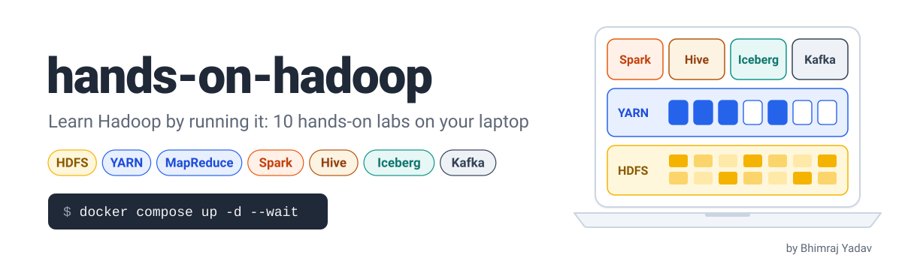
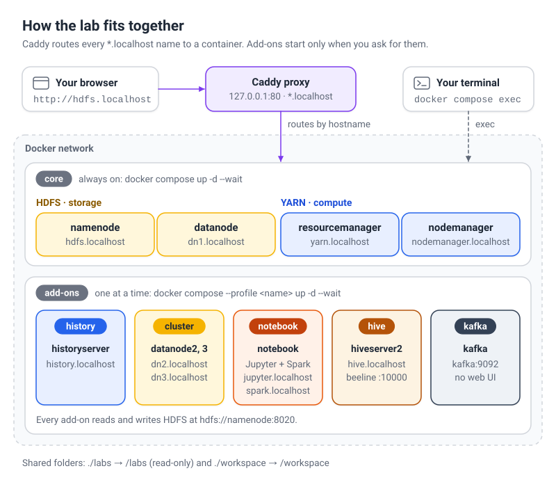
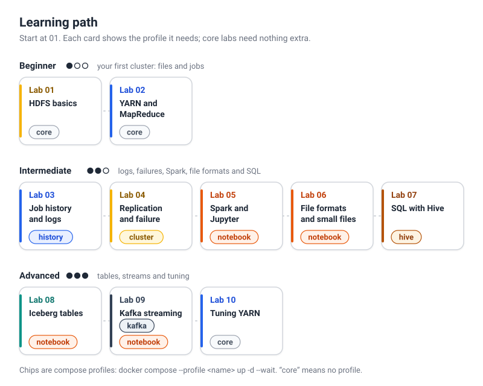
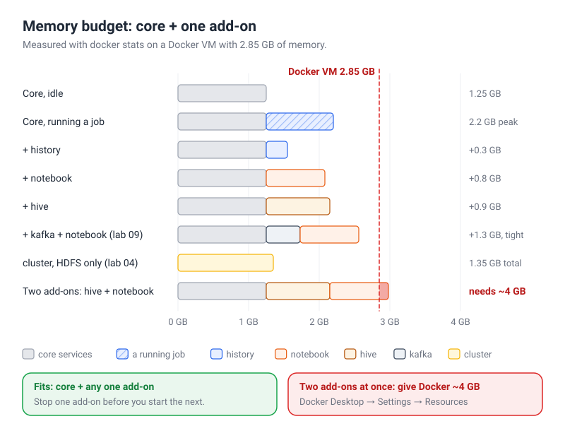

<p align="center">
  
</p>

<p align="center">
  <a href="https://github.com/bhimrazy/hands-on-hadoop/actions/workflows/labs.yml"></a>
  <a href="https://github.com/bhimrazy/hands-on-hadoop/actions/workflows/lint.yml"></a>
  <a href="LICENSE"></a>
</p>

A real Hadoop cluster on your laptop, and ten short labs that take you from your first `hdfs dfs -ls` to Iceberg tables and Kafka streaming. Every lab tells you what you should see, checks your work with one command, and shows you how to break things on purpose.

- **Small:** runs in about 3 GB of Docker memory.
- **Official images:** `apache/hadoop`, `apache/hive`, `apache/kafka` and `spark`, all pinned by digest.
- **Tested:** CI runs every lab end to end on every change.

## Quick start

You need [Docker Desktop](https://docs.docker.com/get-started/get-docker/) (or Docker Engine with Compose v2.20+) and about **3 GB of memory** set aside for Docker.

```bash
git clone https://github.com/bhimrazy/hands-on-hadoop.git
cd hands-on-hadoop
bash scripts/preflight.sh        # Windows PowerShell: .\scripts\preflight.ps1
docker compose up -d --wait
```

`preflight` checks that Docker is running and has enough memory. The first start downloads the images. Later starts take well under a minute. When the command returns, HDFS is ready to write to. Open <http://hdfs.localhost> and you should see the NameNode overview with one live DataNode.

Then go to **[Lab 01: HDFS basics](labs/01-hdfs-basics/README.md)**.

## How it fits together

<p align="center">
  
</p>

The **core** (HDFS and YARN) starts by default. Each **add-on** is a Compose profile you switch on for the labs that need it: `history`, `cluster`, `notebook`, `hive` or `kafka`.

| Open | What it is | Needs |
|---|---|---|
| <http://hdfs.localhost> | HDFS NameNode: files, blocks, DataNodes | core |
| <http://yarn.localhost> | YARN ResourceManager: jobs and containers | core |
| <http://history.localhost> | Finished jobs, counters and logs | `history` |
| <http://jupyter.localhost> | JupyterLab with PySpark | `notebook` |
| <http://spark.localhost> | Spark UI of the running notebook session | `notebook` |
| <http://hive.localhost> | HiveServer2 web UI | `hive` |

`*.localhost` names resolve to your own machine in every modern browser, so no hosts-file edits are needed.

## The labs

<p align="center">
  
</p>

| # | Lab | Level | Add-on | Time |
|---|---|---|---|---|
| 01 | [HDFS basics](labs/01-hdfs-basics/README.md) | Beginner | | 30 min |
| 02 | [YARN and MapReduce](labs/02-yarn-and-mapreduce/README.md) | Beginner | | 45 min |
| 03 | [Job history and logs](labs/03-job-history-and-logs/README.md) | Intermediate | `history` | 30 min |
| 04 | [Replication and failure](labs/04-replication-and-failure/README.md) | Intermediate | `cluster` | 30 min |
| 05 | [Spark and Jupyter](labs/05-spark-and-jupyter/README.md) | Intermediate | `notebook` | 25 min |
| 06 | [File formats and small files](labs/06-file-formats-and-small-files/README.md) | Intermediate | `notebook` | 30 min |
| 07 | [SQL with Hive](labs/07-sql-with-hive/README.md) | Intermediate | `hive` | 30 min |
| 08 | [Iceberg tables](labs/08-iceberg-tables/README.md) | Advanced | `notebook` | 30 min |
| 09 | [Kafka streaming into HDFS](labs/09-kafka-streaming/README.md) | Advanced | `kafka` + `notebook` | 60 min |
| 10 | [Tuning YARN](labs/10-tuning-yarn/README.md) | Advanced | | 45 min |

Every lab follows the same shape: **Start → Steps with expected output → Check yourself → Break it on purpose → Going further → Troubleshooting → Clean up.** Solutions are folded away until you open them.

Each lab has a script that checks your work. For lab 01:

```bash
docker compose exec namenode bash /labs/01-hdfs-basics/check.sh
```

```text
PASS  sample.txt is in /lab01
PASS  /lab01/sample.txt has the sample text
PASS  numbers.txt is in /lab01
PASS  numbers.txt is split into 3 blocks
...
```

## Everyday commands

| I want to… | Run |
|---|---|
| Start the core | `docker compose up -d --wait` |
| Start the core plus an add-on | `docker compose --profile notebook up -d --wait` |
| Open a shell with `hdfs`, `yarn` and `mapred` | `docker compose exec namenode bash` |
| See what's running | `docker compose --profile "*" ps` |
| Stop everything, keep data | `docker compose --profile "*" down` |
| Stop and wipe all data | `docker compose --profile "*" down -v` |

Use `--profile "*"` when stopping. A plain `down` leaves add-on containers running. Each lab's **Start** section has the exact command for that lab.

## Memory

<p align="center">
  
</p>

The core plus **one** add-on fits in 3 GB. To run two add-ons together, give Docker about 4 GB. Lab 09 is the only lab that needs two. It fits in 3 GB but leans on swap. [docs/memory.md](docs/memory.md) has the per-service numbers and how to change Docker's memory on Mac, Windows and Linux.

## Good to know

- **Apple Silicon works.** The official Hadoop image is amd64-only, so it runs under emulation. It is slower but fine for these labs. Turn on *Use Rosetta for x86_64/amd64 emulation* in Docker Desktop for a speed-up.
- **Spark and Hive run beside YARN, not on it.** The Hadoop image ships Java 11, and Spark 4 and Hive 4 need Java 17 or newer. Both still read and write HDFS. Labs 05 and 07 explain what changes on a real cluster.
- **Data survives restarts.** HDFS lives in Docker volumes until you run `down -v`.

## When something goes wrong

Start with [docs/troubleshooting.md](docs/troubleshooting.md). It is organised by symptom: "port 80 is busy", "safe mode", "Java heap space" and more. If you set up Hadoop by hand on a VM before, [docs/vm-install-comparison.md](docs/vm-install-comparison.md) maps each manual step (SSH keys, `*-site.xml`, `start-dfs.sh`, `jps`) to what this repo does instead.

## How it's tested

- **Labs, on every push and pull request:** each lab's solution runs end to end on a fresh stack, then the lab's own check, on both x64 and arm64 Linux runners. On arm64 the Hadoop image runs under emulation, just as on Apple Silicon.
- **Platforms:** the preflight scripts and shell scripts are checked on Linux, macOS and Windows (bash 3.2, PowerShell 5.1 and 7), including that a Windows checkout keeps LF line endings. GitHub's macOS and Windows runners can't run these Linux containers, so the labs themselves run on Linux.
- **Lint:** workflows, Dockerfile, shell scripts, Compose file and links.
- **Supply chain:** images and actions are pinned by digest or commit SHA. Dependabot proposes updates after a 7-day cooldown.

## Contributing

Bug reports, lab ideas and fixes are welcome. See [CONTRIBUTING.md](CONTRIBUTING.md).

## License

[Apache-2.0](LICENSE). Apache Hadoop, Spark, Hive, Kafka and Iceberg are trademarks of the Apache Software Foundation. This project is not affiliated with or endorsed by it.
