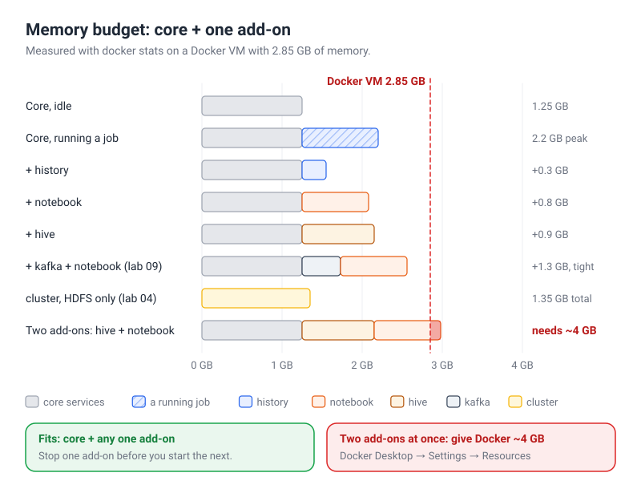

# Memory

All labs run on a laptop with Docker Desktop. The core cluster (HDFS and YARN) idles at about 1.25 GB and peaks near 2.2 GB while a job runs. Everything else is an **add-on** that you start with a profile.



## The rule

**Core + one add-on fits in 3 GB. Core + two add-ons needs about 4 GB.**

The numbers below were measured in a Docker VM with 2.85 GB, 4 CPUs and 1 GB swap. "Idle" is a started cluster doing nothing; "peak" is the highest total seen while running the lab.

## Per service

Each container has a hard memory limit, so one greedy process can't take down the rest. The limit is a ceiling, not a reservation, so limits can add up to more than Docker has.

| Service | Profile | Limit | Measured |
|---|---|---|---|
| `namenode` | core | 512 MB | peak about 385 MB |
| `datanode` | core | 384 MB | peak about 280 MB |
| `resourcemanager` | core | 512 MB | peak about 415 MB |
| `nodemanager` | core | 1 GB (768 MB lent to jobs) | peak about 870 MB |
| `proxy` (Caddy) | core | 64 MB | about 15 MB |
| `historyserver` | `history` | see `compose.yaml` | 270 to 320 MB |
| `datanode2`, `datanode3` | `cluster` | 256 MB each | about 150 to 200 MB each |
| `hiveserver2` | `hive` | 1 GB | 700 to 900 MB |
| `kafka` | `kafka` | 512 MB | 330 MB idle, peak 480 MB |
| `notebook` | `notebook` | 1.5 GB | about 650 MB, up to 830 MB with a stream |

## Per profile

| What you start | Idle | Peak while working | Fits in 3 GB? |
|---|---|---|---|
| core | about 1.25 GB | 2.2 GB | Yes |
| core + `history` | about 1.55 GB | 2.35 GB | Yes |
| `cluster` (HDFS only, lab 04) | about 1.35 GB | 1.4 GB | Yes |
| core + `notebook` | about 1.9 GB | 2.3 GB | Yes |
| core + `hive` | about 1.95 GB | 2.4 GB | Yes, tight |
| core + `kafka` + `notebook` (lab 09) | about 2.0 GB | 2.35 GB | Yes, swap nearly used up |
| core + any two other add-ons | | above 3 GB | Needs about 4 GB |

Idle numbers for add-ons are core idle plus that add-on's own use; peaks were measured.

Swap is slow. A cluster that lives in swap works, but a job can take several times longer.

## Give Docker more memory

Check what you have: Docker Desktop **Settings → Resources** shows Memory, or run `docker info --format '{{.MemTotal}}'` (bytes).

**Mac (Docker Desktop):** Settings → Resources → set Memory to 4 GB or more → **Apply & restart**.

**Windows with the WSL2 backend (the default):** Docker Desktop's memory is whatever WSL2 gets. Create or edit `%UserProfile%\.wslconfig`:

```ini
[wsl2]
memory=4GB
swap=2GB
```

Then, in PowerShell:

```powershell
wsl --shutdown
```

and start Docker Desktop again. Windows with Hyper-V: Settings → Resources, as on a Mac.

**Linux:** containers use the host's memory directly. Nothing to configure unless your machine itself is short.

## If memory is too low

- A container exits with **code 137** (`docker inspect <container> --format '{{.State.OOMKilled}}'` says `true`). The most common victim is the `nodemanager`, and then jobs hang.
- A job stays `ACCEPTED` or a task dies partway through.
- The notebook kernel restarts, or Spark says `Java heap space`.
- Everything slows down and the disk light stays on: the VM is swapping.

What to do, in order: stop what you don't need (`docker compose --profile "*" down`, then start only this lab's profiles), run one job at a time, close memory-hungry apps, then raise Docker's memory as above.
