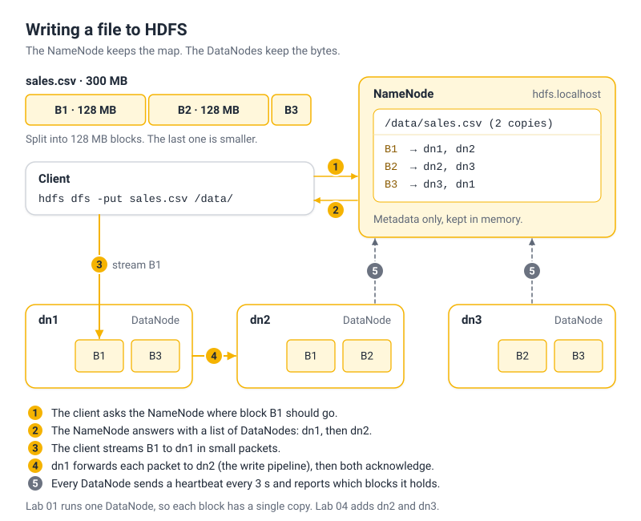

# Lab 01: HDFS basics

Put a file into HDFS, see how it is cut into blocks, and learn to read the cluster from both the shell and the web UI.

| | |
|---|---|
| ⏱ Time | 30 minutes |
| 🧠 Docker memory | about 1.5 GB |
| 🧩 Services | the core stack (this lab uses `namenode`, `datanode` and `proxy`) |
| Level | Beginner |

HDFS stores big files by cutting them into **blocks**. The **NameNode** remembers which blocks make up each file. The **DataNodes** keep the blocks.



## Start

New here? Do the [Quick start](../../README.md#quick-start) first. It clones the repo and checks that Docker is ready.

In a terminal, from the repo root:

```bash
docker compose up -d --wait
```

Check it is up: open <http://hdfs.localhost>. The page should say **active** near the top and **Safemode is off** under Summary.

Then open a shell inside the `namenode` container. The Hadoop commands are installed there, so every command in **Steps** runs in this shell.

```bash
docker compose exec namenode bash
```

The prompt changes: you are now inside the container. Type `exit` when you want to go back to your laptop's terminal.

## Steps

### 1. Wait for HDFS to be writable

Right after startup, HDFS is read-only for a few seconds. This is **safe mode**. This command returns once it is over.

```bash
hdfs dfsadmin -safemode wait
```

You should see:

```
Safe mode is OFF
```

### 2. Make a folder and upload a file

`/lab01` is a folder in HDFS. It is not a folder on your laptop. The repo's `labs/` folder is mounted at `/labs`, so you can upload from there.

```bash
hdfs dfs -mkdir -p /lab01
hdfs dfs -put /labs/01-hdfs-basics/data/sample.txt /lab01/
hdfs dfs -ls /lab01
```

You should see:

```
Found 1 items
-rw-r--r--   1 hadoop supergroup        196 2026-11-18 10:02 /lab01/sample.txt
```

The `1` after the permissions is the **replication factor**: one copy of each block, because this stack has one DataNode. Lab 04 uses more.

### 3. Read it back

`-cat` prints a file. `-get` copies it out of HDFS. The container's `/workspace` folder is the repo's `workspace/` folder on your laptop, so the copy lands there.

```bash
hdfs dfs -cat /lab01/sample.txt
hdfs dfs -get /lab01/sample.txt /workspace/sample-copy.txt
```

You should see the four lines of text, and a new `workspace/sample-copy.txt` on your laptop.

### 4. Look at it in the web UI

Open <http://hdfs.localhost>, then **Utilities > Browse the file system**. Click `lab01`, then `sample.txt`. A window shows the file's size, replication and **block ID**. It also has a **Head the file** button.

This is the same data you just read in the shell. The shell and the UI both ask the NameNode.

### 5. Make a file that needs more than one block

The default block size is 128 MB, so a small file is always one block. To see blocks without a huge file, make a 2.6 MB file of numbers and ask HDFS for 1 MB blocks.

```bash
seq 1 400000 > /workspace/numbers.txt
ls -lh /workspace/numbers.txt
hdfs dfs -D dfs.blocksize=1m -put /workspace/numbers.txt /lab01/
```

You should see a line that ends like this (`put` prints nothing when it works):

```
... 2.6M ... /workspace/numbers.txt
```

`-D dfs.blocksize=1m` changes the setting for this one command only.

### 6. Count the blocks with fsck

`fsck` (file system check) asks the NameNode how a file is stored.

```bash
hdfs fsck /lab01/numbers.txt -files -blocks -locations
```

You should see (trimmed):

```
/lab01/numbers.txt 2688895 bytes, replicated: replication=1, 3 block(s):  OK
0. BP-...:blk_... len=1048576 Live_repl=1  [DatanodeInfoWithStorage[...]]
1. BP-...:blk_... len=1048576 Live_repl=1  [DatanodeInfoWithStorage[...]]
2. BP-...:blk_... len=591743 Live_repl=1  [DatanodeInfoWithStorage[...]]
...
 Total blocks (validated):	3 (avg. block size 896298 B)
...
The filesystem under path '/lab01/numbers.txt' is HEALTHY
```

Three blocks: two full 1 MB blocks (`len=1048576`) and a smaller last one. The last block only takes the space it needs.

Open the file in the web UI again. The block list now has three entries.

### 7. See what is using the space

`-ls -R` lists a folder and everything under it. `-du` shows the size of each file, and `-df` shows how full HDFS is.

```bash
hdfs dfs -ls -R /lab01
hdfs dfs -du -h /lab01
hdfs dfs -df -h /
```

You should see (sizes will differ a little):

```
-rw-r--r--   1 hadoop supergroup    2688895 ... /lab01/numbers.txt
-rw-r--r--   1 hadoop supergroup        196 ... /lab01/sample.txt
2.6 M  2.6 M  /lab01/numbers.txt
196    196    /lab01/sample.txt
Filesystem              Size  Used  Available  Use%
hdfs://namenode:8020     ...
```

`-du` prints two sizes: the file size, and the size including all replicas. They match here because replication is 1.

## Check yourself

Every lab has a script that checks your work. In the namenode shell:

```bash
bash /labs/01-hdfs-basics/check.sh
```

You should see:

```
PASS  sample.txt is in /lab01
PASS  /lab01/sample.txt has the sample text
PASS  numbers.txt is in /lab01
PASS  numbers.txt is split into 3 blocks

All 4 checks passed
```

A `FAIL` line comes with a hint that says which step to repeat. From your laptop's terminal, the same check is `docker compose exec namenode bash /labs/01-hdfs-basics/check.sh`.

## Break it on purpose

**Upload the same file twice.**

```bash
hdfs dfs -put /labs/01-hdfs-basics/data/sample.txt /lab01/
```

You should see:

```
put: `/lab01/sample.txt': File exists
```

HDFS never overwrites by accident. Add `-f` to replace the file: `hdfs dfs -put -f ...`.

**Read a path that is not there.**

```bash
hdfs dfs -cat /lab01/missing.txt
```

You should see:

```
cat: `/lab01/missing.txt': No such file or directory
```

Both messages come from the NameNode. It checks the path before any DataNode is asked for data.

## Going further

1. Find how many blocks a 5 MB file gets with `-D dfs.blocksize=2m`.

   <details><summary>Solution</summary>

   Three: 2 MB, 2 MB and about 1.2 MB.

   ```bash
   seq 1 800000 > /workspace/five.txt
   hdfs dfs -D dfs.blocksize=2m -put /workspace/five.txt /lab01/
   hdfs fsck /lab01/five.txt -files -blocks | grep "Total blocks"
   ```

   </details>

2. Remove everything you made in this lab, then confirm it is gone.

   <details><summary>Solution</summary>

   ```bash
   hdfs dfs -rm -r /lab01
   hdfs dfs -ls /
   ```

   With no trash configured the delete is immediate.

   </details>

3. Open <http://hdfs.localhost> and find the **Datanodes** tab. How much capacity does the DataNode report? (After exercise 2 the check script fails, as it should: the files are gone.)

## Troubleshooting

| Symptom | Fix |
|---|---|
| `Name node is in safe mode` | HDFS just started. Run `hdfs dfsadmin -safemode wait`, then retry. |
| `hdfs.localhost` does not load | Run `docker compose ps`. If `proxy` or `namenode` is not running, run `docker compose up -d --wait` again. |
| `put: ... is less than the minimum block size` | The block size must be at least 1 MB. Use `-D dfs.blocksize=1m`. |
| Download from the UI fails | Reload the page and try again. The link goes through `dn1.localhost`. Or use `hdfs dfs -get` as in step 3. |
| `docker: command not found` | You are still inside the namenode shell. Type `exit`, then run the `docker compose` command on your laptop. |

More in [docs/troubleshooting.md](../../docs/troubleshooting.md).

## Clean up

Type `exit` to leave the namenode shell. Leave the stack running for the next lab, or stop it from the repo root. Your HDFS files stay either way.

```bash
docker compose --profile "*" down
```

`--profile "*"` also stops the add-ons that later labs start, so this one command always stops everything.

Next: [Lab 02, YARN and MapReduce](../02-yarn-and-mapreduce/README.md).
