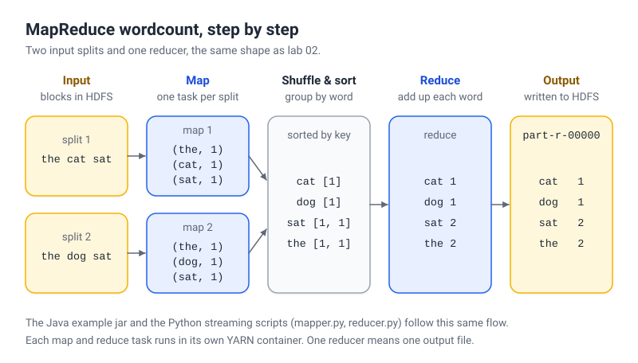
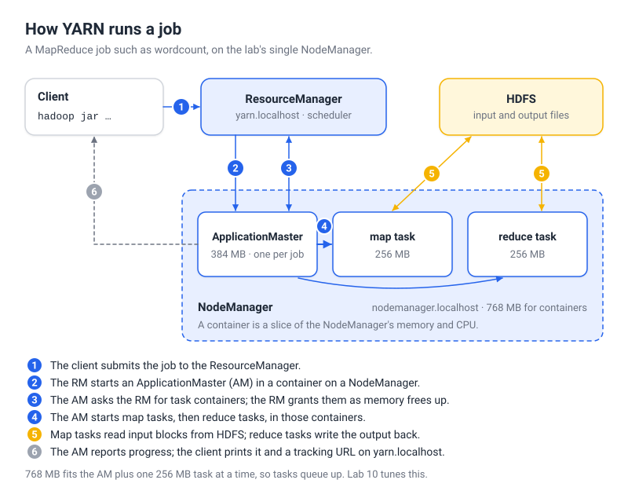

# Lab 02: YARN and MapReduce

Run word count twice, once in Java and once in Python, and watch YARN run it.

| | |
|---|---|
| ⏱ Time | 45 minutes |
| 🧠 Docker memory | about 2.2 GB at peak |
| 🧩 Services | the core stack (`namenode`, `datanode`, `resourcemanager`, `nodemanager`, `proxy`) |
| Level | Beginner |

**MapReduce** is a way to count things in a huge pile of data. Each machine counts its own part (**map**). The partial counts are grouped by word (**shuffle**). Then one place adds them up (**reduce**).



**YARN** decides where the work runs. The **ResourceManager** hands out CPU and memory. The **NodeManager** starts the work in **containers**.



## Start

From the repo root:

```bash
docker compose up -d --wait
```

Check it is up: open <http://yarn.localhost>. The **Active Nodes** count should be `1`.

Open a shell in the `namenode` container. Every command in **Steps** runs there.

```bash
docker compose exec namenode bash
```

## Steps

### 1. Upload the input

A job reads its input from HDFS, so the text has to be there first. The story is a short text with no punctuation, so every word is easy to count.

```bash
hdfs dfsadmin -safemode wait
hdfs dfs -mkdir -p /lab02/input
hdfs dfs -put /labs/02-yarn-and-mapreduce/data/story.txt /lab02/input/
```

### 2. Run the Java word count

Hadoop ships with a jar of example jobs. `wordcount` takes an input folder and an output folder. The output folder must not exist yet. Start the job, then go straight to step 3 in your browser.

```bash
hadoop jar /opt/hadoop/share/hadoop/mapreduce/hadoop-mapreduce-examples-3.4.2.jar \
  wordcount /lab02/input /lab02/out-java
```

The first job takes about 45 seconds, longer on Apple Silicon. You should see (trimmed):

```
INFO mapreduce.Job: The url to track the job: http://yarn.localhost:80/proxy/application_..._0001/
INFO mapreduce.Job: Running job: job_..._0001
INFO mapreduce.Job:  map 0% reduce 0%
INFO mapreduce.Job:  map 100% reduce 0%
INFO mapreduce.Job:  map 100% reduce 100%
INFO mapreduce.Job: Job job_..._0001 completed successfully
```

A long list of counters follows. Lab 03 shows how to read them.

### 3. Watch it in the YARN UI

Open <http://yarn.localhost>. Your job is the newest row in the table. Reload the page to watch its **State** go from `ACCEPTED` to `RUNNING` to `FINISHED`.

Look for two things:

- The **ApplicationMaster** (AM). It is the first container YARN starts. It asks for more containers, one per task, and tracks them.
- The **containers**. In **Nodes**, the NodeManager shows how much memory is used. The AM and the map task run at the same time, so memory briefly goes up.

The job is tiny, so you will see one map task and one reduce task. A big file would get one map task per block.

### 4. Read the result

The job wrote its output to HDFS. `sort -k2,2nr` orders the lines by the count in the second column, biggest first.

```bash
hdfs dfs -ls /lab02/out-java
hdfs dfs -cat /lab02/out-java/part-r-00000 | sort -k2,2nr | head -5
```

You should see:

```
Found 2 items
-rw-r--r--   1 hadoop supergroup          0 ... /lab02/out-java/_SUCCESS
-rw-r--r--   1 hadoop supergroup        231 ... /lab02/out-java/part-r-00000
the	12
a	7
elephant	7
river	5
and	4
```

`_SUCCESS` is an empty marker. `part-r-00000` is the output of reduce task number 0. A job with three reducers would write three `part-r-` files.

### 5. Write the same job in Python

**Hadoop Streaming** runs any program as the mapper or reducer. The program reads lines on standard input and writes `key<TAB>value` lines on standard output. Open [`mapper.py`](mapper.py) and [`reducer.py`](reducer.py): each is about ten lines.

The reducer relies on one promise: Hadoop sorts the mapper output by key, so all the lines for one word arrive together.

Test them without Hadoop first. `sort` stands in for the shuffle.

```bash
cat /labs/02-yarn-and-mapreduce/data/story.txt \
  | python3 /labs/02-yarn-and-mapreduce/mapper.py \
  | sort \
  | python3 /labs/02-yarn-and-mapreduce/reducer.py \
  | head -3
```

You should see:

```
a	7
and	4
big	4
```

Now run it on the cluster. `-files` copies the scripts to every container that needs them.

```bash
mapred streaming \
  -files /labs/02-yarn-and-mapreduce/mapper.py,/labs/02-yarn-and-mapreduce/reducer.py \
  -mapper "python3 mapper.py" -reducer "python3 reducer.py" \
  -input /lab02/input -output /lab02/out-python
```

You should see the same `completed successfully` line. This runs `hadoop-streaming-3.4.2.jar`, in `/opt/hadoop/share/hadoop/tools/lib/`.

### 6. Compare the two outputs

`diff` prints nothing when two inputs are equal, so `same` only appears if the Java and Python results match.

```bash
diff <(hdfs dfs -cat /lab02/out-java/part-r-00000) \
     <(hdfs dfs -cat /lab02/out-python/part-00000) && echo "same"
```

You should see:

```
same
```

Two languages, one answer. The Python output is `part-00000`, with no `r`, because the streaming job names its files differently.

## Check yourself

In the namenode shell:

```bash
bash /labs/02-yarn-and-mapreduce/check.sh
```

You should see:

```
PASS  story.txt is in /lab02/input
PASS  the Java wordcount finished
PASS  Java output counts the word elephant
PASS  the Python streaming job finished
PASS  Python output counts the word elephant
PASS  Java and Python give the same counts

All 6 checks passed
```

From your laptop's terminal, the same check is `docker compose exec namenode bash /labs/02-yarn-and-mapreduce/check.sh`.

## Break it on purpose

**Run the Java job again, into the same output folder.**

```bash
hadoop jar /opt/hadoop/share/hadoop/mapreduce/hadoop-mapreduce-examples-3.4.2.jar \
  wordcount /lab02/input /lab02/out-java
```

You should see:

```
org.apache.hadoop.mapred.FileAlreadyExistsException: Output directory hdfs://namenode:8020/lab02/out-java already exists
```

The job stops before it starts, and nothing new shows up in the YARN UI. Hadoop refuses to overwrite old results. To run a job again, pick a new output folder, or delete the old one first with `hdfs dfs -rm -r <folder>`. Keep `/lab02/out-java` for now: the check script and lab 05 use it.

## Going further

1. Run the example `pi` job and watch more containers appear in the YARN UI.

   <details><summary>Solution</summary>

   ```bash
   hadoop jar /opt/hadoop/share/hadoop/mapreduce/hadoop-mapreduce-examples-3.4.2.jar pi 4 100
   ```

   It starts four map tasks, so the NodeManager may queue some while others run. It prints an estimate of pi near the end.

   </details>

2. Use three reducers and count the output files.

   <details><summary>Solution</summary>

   ```bash
   hdfs dfs -rm -r -f /lab02/out-three
   hadoop jar /opt/hadoop/share/hadoop/mapreduce/hadoop-mapreduce-examples-3.4.2.jar \
     wordcount -D mapreduce.job.reduces=3 /lab02/input /lab02/out-three
   hdfs dfs -ls /lab02/out-three
   ```

   You get `part-r-00000`, `part-r-00001` and `part-r-00002`. Each word lands in exactly one of them.

   </details>

3. Change the Python mapper to skip words shorter than three letters. Does the Java output still match?

## Troubleshooting

| Symptom | Fix |
|---|---|
| Job stays at `ACCEPTED` | The NodeManager is out of memory or still starting. Wait a minute, then check <http://yarn.localhost> for running jobs. See [docs/memory.md](../../docs/memory.md). |
| `Streaming Command Failed!` with `exit 127` | Python was not found. Use `python3` in `-mapper` and `-reducer`, not `python`. |
| `Name node is in safe mode` | Run `hdfs dfsadmin -safemode wait`, then retry. |
| A **Logs** or **History** link in the YARN UI returns a 502 error | Those links go to the history server, which is not running yet. Lab 03 starts it. |

More in [docs/troubleshooting.md](../../docs/troubleshooting.md).

## Clean up

Type `exit` to leave the namenode shell. Leave the stack running for the next lab, or stop it:

```bash
docker compose --profile "*" down
```

Next: [Lab 03, Job history and logs](../03-job-history-and-logs/README.md).
