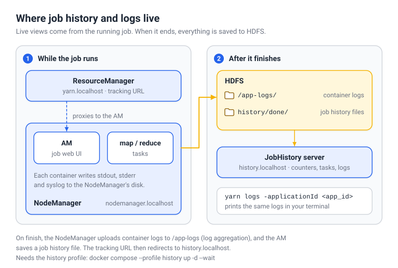

# Lab 03: Job history and logs

Find out what a finished job did, and find the error when a job fails.

| | |
|---|---|
| ⏱ Time | 30 minutes |
| 🧠 Docker memory | about 2.4 GB at peak |
| 🧩 Services | the core stack plus `historyserver` (profile `history`) |
| Level | Intermediate |

When a job ends, its containers and their logs go away, and YARN keeps only a one-line summary. Two things keep the full story:

- The **JobHistory server** keeps a record of every finished job: counters, task times, status.
- **Log aggregation** copies each container's logs into HDFS (`/app-logs`) when the job ends.



## Start

This lab needs the history server on top of the core stack. It is an add-on, and you switch add-ons on with `--profile`. From the repo root:

```bash
docker compose --profile history up -d --wait
```

Check it is up: open <http://history.localhost>. You should see the JobHistory page. The job table is empty if this is your first job since the history server started.

Open a shell in the `namenode` container. Every command in **Steps** runs there.

```bash
docker compose exec namenode bash
```

## Steps

### 1. Run a job so there is a history

Upload the two input files for this lab, then run the word count from lab 02 on the first one.

```bash
hdfs dfsadmin -safemode wait
hdfs dfs -mkdir -p /lab03/notes /lab03/orders
hdfs dfs -put /labs/03-job-history-and-logs/data/notes.txt /lab03/notes/
hdfs dfs -put /labs/03-job-history-and-logs/data/orders.csv /lab03/orders/

hadoop jar /opt/hadoop/share/hadoop/mapreduce/hadoop-mapreduce-examples-3.4.2.jar \
  wordcount /lab03/notes /lab03/out-notes
```

You should see `completed successfully` and a tracking URL like `http://yarn.localhost:80/proxy/application_.../`.

### 2. Open the job in the history UI

Open <http://history.localhost>. Your job is in the table with state `SUCCEEDED`. Click its **Job ID**.

The job page shows how many maps and reduces ran, and how long each took. Click **Counters** in the left menu.

You should see numbers like these:

| Counter | Value | Meaning |
|---|---|---|
| Map input records | 3 | lines in the file |
| Map output records | 21 | one `(word, 1)` per word |
| Reduce input groups | 14 | different words |

Counters are the first thing to check when a job gives odd results. Fewer input records than lines in your file is a classic sign of a bad input format.

You can also click the **map** link, then a task, then **logs**. This opens the same logs you get from the shell in the next step.

### 3. Read the logs from the shell

First list the finished applications and copy the ID.

```bash
yarn application -list -appStates FINISHED
```

You should see:

```
Application-Id           Application-Name  ...  State     Final-State  Progress  Tracking-URL
application_..._0001     word count        ...  FINISHED  SUCCEEDED    100%      http://history.localhost:80/jobhistory/job/job_..._0001
```

Then fetch its logs. Replace `<application id>` with your own, for example `application_1763460000000_0001`.

```bash
yarn logs -applicationId <application id> | head -30
```

You should see (trimmed):

```
Container: container_..._0001_01_000001 on nodemanager.localhost_...
LogAggregationType: AGGREGATED
LogType:syslog
LogContents:
... INFO [main] org.apache.hadoop.mapreduce.v2.app.MRAppMaster: ...
```

Container `_000001` is the ApplicationMaster. The other containers ran the map and reduce tasks. If you see `Log aggregation has not completed or is not enabled`, wait ten seconds and run it again.

Both kinds of record are plain files in HDFS. The first command finds the `.jhist` file behind the history UI. The second lists the aggregated logs.

```bash
hdfs dfs -ls -R /tmp/hadoop-yarn/staging/history/done | grep jhist
hdfs dfs -ls /app-logs
```

### 4. Know where logs live

| When | Where |
|---|---|
| While the job runs | On the NodeManager's disk. Open the AM link in <http://yarn.localhost>. |
| After the job ends | In HDFS under `/app-logs`. Read them with `yarn logs` or <http://history.localhost>. |

If you ever see "logs not found" after a job ends, check that log aggregation is on. In this stack it is.

### 5. Run a job that fails on purpose

[`orders.csv`](data/orders.csv) has one bad row: `ruler,n/a`. The mapper [`order-mapper.py`](order-mapper.py) turns the price into a number, so it crashes on that row.

`-D mapreduce.map.maxattempts=1` stops Hadoop from retrying four times. `-D mapreduce.job.name=orders-bad` gives the job a name you can find.

```bash
mapred streaming \
  -D mapreduce.job.name=orders-bad \
  -D mapreduce.map.maxattempts=1 \
  -files /labs/03-job-history-and-logs/order-mapper.py,/labs/03-job-history-and-logs/sum-reducer.py \
  -mapper "python3 order-mapper.py" -reducer "python3 sum-reducer.py" \
  -input /lab03/orders -output /lab03/out-orders-bad
```

You should see (trimmed):

```
INFO mapreduce.Job: Task Id : attempt_..._0002_m_000000_0, Status : FAILED
Error: java.lang.RuntimeException: PipeMapRed.waitOutputThreads(): subprocess failed with code 1
...
Job failed as tasks failed. failedMaps:1 failedReduces:0
ERROR streaming.StreamJob: Job not successful!
Streaming Command Failed!
```

The console only says the Python process exited with code 1. It does not say why. The reason is in the logs.

### 6. Find the stack trace

Get the ID of the failed job.

```bash
yarn application -list -appStates ALL | grep orders-bad
```

Then ask for the `stderr` logs only. This is where Python prints its traceback.

```bash
yarn logs -applicationId <application id> -log_files stderr
```

You should see, among the output:

```
Container: container_..._0002_01_000002 on nodemanager.localhost_...
LogType:stderr
LogContents:
Traceback (most recent call last):
  File "order-mapper.py", line 6, in <module>
    print(f"{product}\t{float(price)}")
ValueError: could not convert string to float: 'n/a'
```

The file path in your traceback may be longer.

That is the whole story: line 6 of the mapper, and the bad value `n/a`.

Now find the same thing in the browser. Open <http://history.localhost>, click the `orders-bad` job (state `FAILED`), then **Failed** under the map tasks, then the attempt's **logs** link.

> A failed job writes no results. Hadoop creates `/lab03/out-orders-bad` when the job starts, so the folder exists but holds no `part-*` files. Delete it before you run the job again.

### 7. Fix the mapper and rerun

[`order-mapper-fixed.py`](order-mapper-fixed.py) catches the bad value and writes a note to `stderr` instead of crashing.

```bash
mapred streaming \
  -D mapreduce.job.name=orders-fixed \
  -files /labs/03-job-history-and-logs/order-mapper-fixed.py,/labs/03-job-history-and-logs/sum-reducer.py \
  -mapper "python3 order-mapper-fixed.py" -reducer "python3 sum-reducer.py" \
  -input /lab03/orders -output /lab03/out-orders-fixed

hdfs dfs -cat /lab03/out-orders-fixed/part-00000
```

You should see:

```
eraser	2.50
notebook	8.00
pencil	7.50
```

The `ruler` row is skipped. Its note is in the job's `stderr` log, which is also where a real pipeline would count its bad rows.

## Check yourself

In the namenode shell:

```bash
bash /labs/03-job-history-and-logs/check.sh
```

You should see:

```
PASS  the notes wordcount finished
PASS  aggregated logs are stored in /app-logs
PASS  the history server has job history files
PASS  the failing job orders-bad ran and failed
PASS  the failed job wrote no result files
PASS  the fixed job wrote totals per product

All 6 checks passed
```

## Break it on purpose

**Ask for logs while the job is still running.** Start a job in the namenode shell:

```bash
hadoop jar /opt/hadoop/share/hadoop/mapreduce/hadoop-mapreduce-examples-3.4.2.jar pi 2 1000
```

While it runs, open a second namenode shell (`docker compose exec namenode bash` in a new terminal). Find the running job's ID and ask for its logs:

```bash
yarn application -list
yarn logs -applicationId <application id>
```

You should see something like:

```
Can not find the logs for the application: application_...
```

or a message that log aggregation has not completed. Aggregation happens when the job ends. While it runs, use the AM link in <http://yarn.localhost> instead.

## Going further

1. Kill a running job from the shell.

   <details><summary>Solution</summary>

   Start the `pi` example with `pi 10 10000` in one namenode shell. In another:

   ```bash
   yarn application -list
   yarn application -kill <application id>
   ```

   The job ends with state `KILLED`. Find it in the history UI, or with `-appStates KILLED`.

   </details>

2. Which of the two jobs from step 1 and step 7 ran longer? Compare the map and reduce times in the history UI.

3. Make the bad row count visible. Change the mapper to print `reporter:counter:orders,bad_rows,1` on `stderr` instead of the note, then find the `bad_rows` counter on the job's **Counters** page.

   <details><summary>Solution</summary>

   Streaming turns any `stderr` line of the form `reporter:counter:<group>,<name>,<amount>` into a counter.

   ```python
   except ValueError:
       print("reporter:counter:orders,bad_rows,1", file=sys.stderr)
   ```

   </details>

## Troubleshooting

| Symptom | Fix |
|---|---|
| `history.localhost` returns 502 | The history server is not running. Run `docker compose --profile history up -d --wait`. |
| `yarn logs` says aggregation has not completed | Wait ten seconds and try again. It runs after the job ends. |
| The history UI shows no jobs | Give it a minute. The server reads new job files from HDFS every few seconds. |
| A log link in the UI shows a connection error | Make sure the address in your browser ends in `.localhost`. A bare `nodemanager` or `historyserver` name cannot be opened from your laptop. |

More in [docs/troubleshooting.md](../../docs/troubleshooting.md).

## Clean up

Type `exit` to leave the namenode shell, then:

```bash
docker compose --profile "*" down
```

A plain `down` would leave the history server running, because it belongs to a profile. Your HDFS files and job history stay.

Next: [Lab 04, Replication and failure](../04-replication-and-failure/README.md). It starts a different set of services, so stop this stack first.
