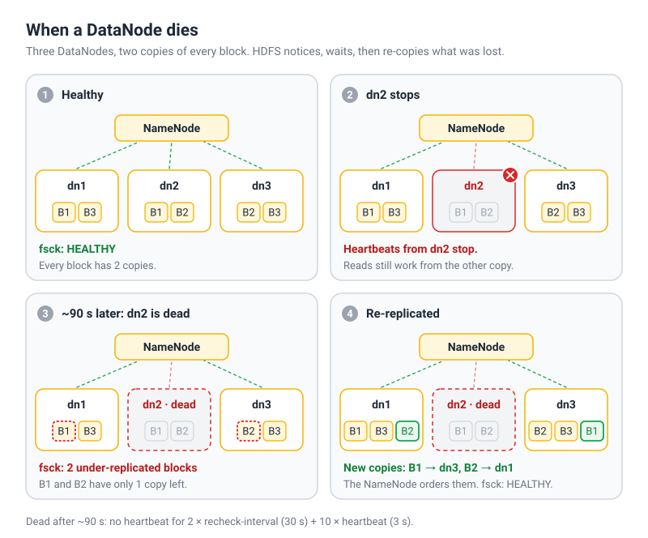

# Lab 04: Replication and failure

Stop a DataNode on purpose and watch HDFS notice, heal itself and clean up.

| | |
|---|---|
| ⏱ Time | 30 minutes |
| 🧠 Docker memory | about 1.4 GB (HDFS only, no YARN) |
| 🧩 Services | `namenode`, `proxy` and three DataNodes (profile `cluster`) |
| Level | Intermediate |

HDFS keeps more than one copy of every block, on different DataNodes. If a DataNode dies, the NameNode notices and makes new copies elsewhere. You never lose the file, as long as one copy survives.



This lab starts only the HDFS part of the stack. Three DataNodes and YARN together would not fit in 3 GB of Docker memory, so there is no YARN here.

## Start

Stop anything left over from another lab, then start HDFS with three DataNodes. Naming the services after `up` starts only those, which leaves YARN out.

```bash
docker compose --profile "*" down
docker compose --profile cluster up -d --wait namenode datanode datanode2 datanode3 proxy
```

Check it is up: open <http://hdfs.localhost> and click **Datanodes**. You should see three entries: `dn1.localhost`, `dn2.localhost` and `dn3.localhost`.

This lab uses two terminals. Open a shell in the `namenode` container in one: every `hdfs` command runs there. Keep a second terminal on your laptop, in the repo root, for the `docker compose` commands.

```bash
docker compose exec namenode bash
```

## Steps

### 1. Look at the cluster

`dfsadmin -report` prints what the NameNode knows about every DataNode. The `grep` keeps only the lines that name them.

```bash
hdfs dfsadmin -safemode wait
hdfs dfsadmin -report | grep -E "^(Live|Dead) datanodes|^Name:|^Hostname:"
```

You should see:

```
Live datanodes (3):
Name: 172.18.0.3:9866 (...)
Hostname: dn1.localhost
Name: 172.18.0.5:9866 (...)
Hostname: dn2.localhost
Name: 172.18.0.4:9866 (...)
Hostname: dn3.localhost
```

The IP addresses and the order will differ. There is no `Dead datanodes` line yet.

### 2. Upload a file with two copies of every block

A file of almost 7 MB with 1 MB blocks gives 7 blocks. With 2 copies each, that is 14 block replicas spread over three DataNodes.

```bash
seq 1 1000000 > /workspace/big-numbers.txt
hdfs dfs -mkdir -p /lab04
hdfs dfs -D dfs.blocksize=1m -D dfs.replication=2 \
  -put /workspace/big-numbers.txt /lab04/
hdfs dfs -stat "replication=%r blocksize=%o" /lab04/big-numbers.txt
```

You should see:

```
replication=2 blocksize=1048576
```

### 3. See where each block lives

`fsck` with `-locations` lists the DataNodes that hold each block.

```bash
hdfs fsck /lab04/big-numbers.txt -files -blocks -locations
```

You should see (trimmed):

```
/lab04/big-numbers.txt 6888896 bytes, replicated: replication=2, 7 block(s):  OK
0. BP-...:blk_... len=1048576 Live_repl=2  [DatanodeInfoWithStorage[172.18.0.3:9866,...], DatanodeInfoWithStorage[172.18.0.4:9866,...]]
1. BP-...:blk_... len=1048576 Live_repl=2  [DatanodeInfoWithStorage[172.18.0.5:9866,...], DatanodeInfoWithStorage[172.18.0.3:9866,...]]
...
 Total blocks (validated):	7 (avg. block size 984128 B)
...
 Under-replicated blocks:	0 (0.0 %)
 Over-replicated blocks:	0 (0.0 %)
...
 Average block replication:	2.0
...
The filesystem under path '/lab04/big-numbers.txt' is HEALTHY
```

Each block has two addresses. They are two different DataNodes. Match the IPs against step 1 to see which node holds which block.

You can also see this in <http://hdfs.localhost>: **Utilities > Browse the file system**, click the file, and pick a block ID. The page lists the DataNodes that hold it.

### 4. Change the replication of an existing file

Replication is a property of each file, and you can change it at any time. `-w` waits until it is done.

```bash
hdfs dfs -setrep -w 3 /lab04/big-numbers.txt
hdfs dfs -setrep -w 2 /lab04/big-numbers.txt
```

You should see (the second command also prints a warning that lowering replication can take a while):

```
Replication 3 set: /lab04/big-numbers.txt
Waiting for /lab04/big-numbers.txt ... done
Replication 2 set: /lab04/big-numbers.txt
Waiting for /lab04/big-numbers.txt ... done
```

With 3 copies, every block is on every DataNode. Going back to 2 makes the NameNode delete one copy of each block.

### 5. Stop a DataNode

In your **laptop** terminal:

```bash
docker compose stop datanode2
```

In the namenode shell, watch the cluster once every 10 seconds:

```bash
for i in $(seq 1 15); do
  date +%T
  hdfs dfsadmin -report | grep -E "^(Live|Dead) datanodes"
  sleep 10
done
```

You should see, over about two minutes:

```
10:31:02
Live datanodes (3):
...
10:32:32
Live datanodes (2):
Dead datanodes (1):
```

For about 90 seconds, nothing happens. The NameNode waits because a DataNode may only be slow or restarting, and copying data around for a hiccup would be wasteful. The Hadoop default wait is about 10 minutes. This stack shortens it to about 90 seconds.

The <http://hdfs.localhost> **Datanodes** tab shows the same: the **Last contact** value of `dn2.localhost` keeps growing, then the node is marked dead.

### 6. Watch the NameNode heal the cluster

Once `dn2` is dead, every block it held has only one copy left. These blocks are **under-replicated**.

```bash
hdfs fsck /lab04 | grep -E "Under-replicated|Average block replication|is HEALTHY"
```

Run it a few times. You should first see something like this (the count depends on how many blocks `dn2` held):

```
 Under-replicated blocks:	4 (57.1 %)
 Average block replication:	1.4285715
```

and, within 10 to 20 seconds, the NameNode has copied those blocks between the two live nodes:

```
 Under-replicated blocks:	0 (0.0 %)
 Average block replication:	2.0
The filesystem under path '/lab04' is HEALTHY
```

The file never stopped being readable. Try it now:

```bash
hdfs dfs -cat /lab04/big-numbers.txt | tail -1
```

You should see `1000000`.

### 7. Bring the DataNode back

On your laptop:

```bash
docker compose start datanode2
```

Wait about 30 seconds, then in the namenode shell:

```bash
hdfs dfsadmin -report | grep -E "^(Live|Dead) datanodes"
hdfs fsck /lab04 | grep -E "Over-replicated|Average block replication"
```

You should see something like:

```
Live datanodes (3):
 Over-replicated blocks:	2 (28.6 %)
 Average block replication:	2.2857144
```

`dn2` still has its old copies on disk. Now some blocks have three copies, where two are wanted. They are **over-replicated**. The NameNode deletes the extras, often within seconds, so you may already see `0`. If not, run the `fsck` line again after a minute. You end at `Over-replicated blocks: 0` and an average of `2.0`.

## Check yourself

Wait until step 7 is done and `dn2` is back. Then, in the namenode shell:

```bash
bash /labs/04-replication-and-failure/check.sh
```

You should see:

```
PASS  big-numbers.txt is in /lab04
PASS  big-numbers.txt has replication 2
PASS  all 3 DataNodes are live
PASS  every block has exactly the replicas it should

All 4 checks passed
```

## Break it on purpose

**Ask for more copies than HDFS can place.** With 3 DataNodes and replication 3, every node holds every block. Then take one away.

```bash
hdfs dfs -setrep -w 3 /lab04/big-numbers.txt
```

On your laptop:

```bash
docker compose stop datanode3
```

Wait about two minutes, then:

```bash
hdfs fsck /lab04 | grep -E "Under-replicated|Average block replication"
```

You should see:

```
 Under-replicated blocks:	7 (100.0 %)
 Average block replication:	2.0
```

Wait as long as you like: it never heals. The NameNode wants 3 copies of each block and there are only 2 live nodes, so there is nowhere to put the third. The data is still safe, but it is less safe than you asked for.

Start `datanode3` again on your laptop and the count drops to 0 on its own:

```bash
docker compose start datanode3
```

Run `hdfs dfs -setrep -w 2 /lab04/big-numbers.txt` to finish. The replication factor must not be higher than the number of DataNodes you can count on.

## Going further

1. Stop two DataNodes at once with replication 2. Can you still read the file?

   <details><summary>Solution</summary>

   Often not. A block whose two copies were on exactly the two stopped nodes is gone until one of them returns, and `hdfs dfs -cat` fails with `BlockMissingException`. With one node left, `fsck` reports missing blocks. Start the nodes again and the file is readable again, because the data is still on their disks.

   </details>

2. How long does the NameNode wait before declaring a node dead? Find the two settings behind it.

   <details><summary>Solution</summary>

   It is `2 x dfs.namenode.heartbeat.recheck-interval + 10 x dfs.heartbeat.interval`. This stack sets the first to 30 seconds and the second keeps its 3-second default: 60 + 30 = 90 seconds. The default recheck interval is 5 minutes, which gives 10.5 minutes.

   </details>

3. Run the balancer with `hdfs balancer -threshold 5`. It moves blocks when one DataNode is much fuller than the others. Why does it do nothing here?

   <details><summary>Solution</summary>

   It prints `The cluster is balanced. Exiting...`. All three DataNodes share one Docker disk, so they always look equally full. On a real cluster the balancer matters after you add new, empty nodes.

   </details>

## Troubleshooting

| Symptom | Fix |
|---|---|
| Fewer than 3 live DataNodes at the start | Run `docker compose --profile cluster up -d --wait namenode datanode datanode2 datanode3 proxy` again. |
| `dn2.localhost` shows a 502 | That DataNode is stopped. This is expected during the lab. |
| Under-replicated count stays above 0 | Check that three DataNodes are live (replication 3 needs all three). Otherwise wait another minute. |

More in [docs/troubleshooting.md](../../docs/troubleshooting.md).

## Clean up

Type `exit` to leave the namenode shell, then:

```bash
docker compose --profile "*" down
```

Your HDFS files stay. Add `-v` to wipe all HDFS data too.

Next: [Lab 05, Spark and Jupyter](../05-spark-and-jupyter/README.md). It starts the core stack again, plus the notebook.
