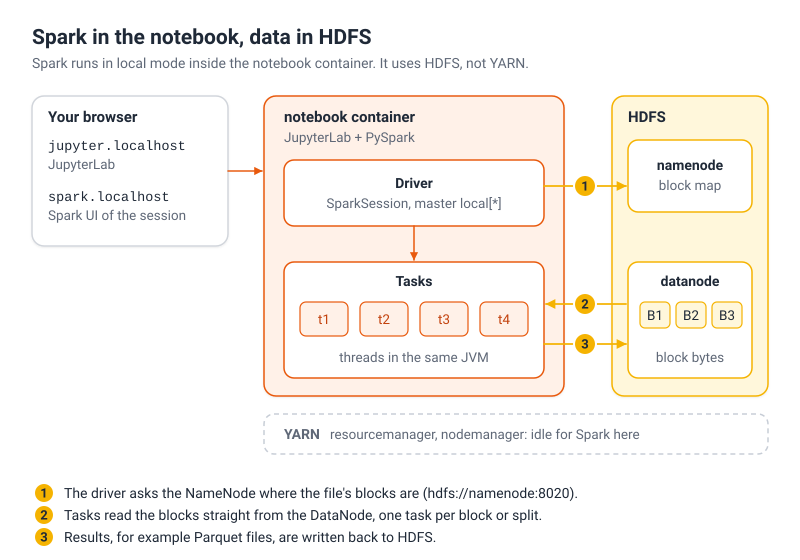

# Lab 05: Spark and Jupyter

Count words with Spark in a notebook, read and write HDFS, and see how it compares with the MapReduce job from lab 02.

| | |
|---|---|
| ⏱ Time | 25 minutes |
| 🧠 Docker memory | about 2.3 GB peak (core + notebook) |
| 🧩 Services | namenode, datanode, resourcemanager, nodemanager, proxy, **notebook** |
| Level | Intermediate |



## The big idea

In lab 02 you wrote a mapper and a reducer by hand. Spark lets you say the same thing in a few lines:
"split lines into words, group by word, count".
It also keeps data in memory between steps, so it is usually much faster than MapReduce.

**Spark runs in local mode here.** That means the whole Spark program (driver and workers) runs as threads inside the notebook container. It does not use YARN.

Why? The Hadoop image in this repo runs Java 11, and Spark 4 needs Java 17 or newer. So Spark lives in its own container with its own Java, and talks to HDFS over the network.

What changes on a real cluster? Almost nothing in your code. You would start Spark with `--master yarn`. YARN would then give Spark containers on many machines, just like it did for MapReduce in lab 02. The DataFrame code stays the same.

## Start

```bash
docker compose --profile notebook up -d --wait
```

You should see (trimmed):

```text
 ✔ Container namenode      Healthy
 ✔ Container notebook      Healthy
```

Check it's up: open <http://jupyter.localhost>. You should see JupyterLab.

## Steps

### 1. Copy the notebook into your workspace

The lab files are mounted read-only. Copy the notebook so you can edit and save it.

```bash
docker compose exec notebook cp /labs/05-spark-and-jupyter/word-count-with-spark.ipynb /workspace/
```

In JupyterLab, double-click `word-count-with-spark.ipynb` in the file browser on the left.

### 2. Start a SparkSession

Run the first code cell (click it, press Shift+Enter). It builds a session:

```python
spark = (
    SparkSession.builder
    .master("local[*]")
    .appName("lab-05-spark-and-jupyter")
    .getOrCreate()
)
```

`local[*]` means "use every CPU core of this container". The app name is what you will see in the Spark UI.

You should see:

```text
Spark 4.1.x
Spark UI: http://spark.localhost
```

### 3. Put some input into HDFS

The next cell makes 20,000 lines of random words and writes them to `hdfs://namenode:8020/user/lab/05/input` with Spark itself.
Nothing to download.

Look at it from the NameNode side in a terminal:

```bash
docker compose exec namenode hdfs dfs -ls /user/lab/05/input
```

You should see:

```text
-rw-r--r--   1 spark supergroup          0 ... /user/lab/05/input/_SUCCESS
-rw-r--r--   1 spark supergroup     ...... ... /user/lab/05/input/part-00000-....txt
-rw-r--r--   1 spark supergroup     ...... ... /user/lab/05/input/part-00001-....txt
```

Two part files, because we asked for two partitions.

### 4. Count the words

```python
words  = text.select(F.explode(F.split(F.lower("value"), r"\s+")).alias("word"))
counts = words.groupBy("word").count().orderBy(F.desc("count"))
counts.show(10)
```

`explode` makes one row per word. `groupBy("word").count()` is the map and reduce in one line.

You should see something like:

```text
+--------+------+
|    word| count|
+--------+------+
|    data| 29...|
|  hadoop| 14...|
|    hdfs|  9...|
...
```

### 5. Read the plan with `explain()`

Spark is lazy. Nothing runs until you ask for a result (`show`, `count`, `write`). `explain()` prints the plan it built:

```text
== Physical Plan ==
AdaptiveSparkPlan isFinalPlan=false
+- Sort [count#.. DESC NULLS LAST], true, 0
   +- Exchange rangepartitioning(count#.. DESC NULLS LAST, 4)
      +- HashAggregate(keys=[word#..], functions=[count(1)])
         +- Exchange hashpartitioning(word#.., 4)
            +- HashAggregate(keys=[word#..], functions=[partial_count(1)])
               +- ... FileScan text [value#..] ... hdfs://namenode:8020/user/lab/05/input
```

Read it from the bottom up:

- `FileScan` reads the text from HDFS.
- The first `HashAggregate` counts words inside each partition (like a combiner).
- `Exchange hashpartitioning` is the **shuffle**: the same word goes to the same partition (like MapReduce shuffle).
- The second `HashAggregate` adds up the partial counts.

### 6. Open the Spark UI

While your notebook session is running, open <http://spark.localhost>.

- **Jobs** lists one job per action (`show`, `write`...). Click one to see its stages.
- **SQL / DataFrame** shows the plan as a picture, with row counts on each arrow.
- **Environment** shows `spark.master = local[*]`.

The UI disappears when the session stops (last cell of the notebook). That is normal.

### 7. Chart it

`toPandas()` brings the top 10 rows into the notebook as a pandas DataFrame, and seaborn draws a bar chart. This is the usual pattern: let Spark crunch big data, then plot the small result.

> Never `toPandas()` a big table. It pulls everything into one process.

### 8. Write Parquet to HDFS

The last cells write the full word counts as Parquet and a top-10 list as one small CSV:

```bash
docker compose exec namenode hdfs dfs -ls /user/lab/05/word-counts-parquet
docker compose exec namenode hdfs dfs -cat /user/lab/05/top-words/*.csv
```

You should see:

```text
word,count
data,29...
hadoop,14...
...
```

The Parquet folder has a `_SUCCESS` marker and one or more `part-....snappy.parquet` files. Lab 06 explains why Parquet is a good default.

## Check yourself

```bash
docker compose exec namenode bash /labs/05-spark-and-jupyter/check.sh
```

You should see:

```text
PASS  input text is in /user/lab/05/input
PASS  word counts were written as Parquet
PASS  Parquet data files exist in /user/lab/05/word-counts-parquet
PASS  top-words CSV lists 'data' as a top word
All 4 checks passed
```

## Break it on purpose

Ask Spark to read a folder that does not exist. In a new cell:

```python
spark.read.text("hdfs://namenode:8020/user/lab/05/nope").show()
```

You should see an `AnalysisException: [PATH_NOT_FOUND] Path does not exist`. Spark checks the path when it builds the plan, before any job starts, so the Spark UI shows no new job.

Now try a wrong NameNode address, `hdfs://nonamenode:8020/...`. This one fails with an `UnknownHostException`. Remember this when a path error and a connection error look alike.

## Going further

1. Compare with lab 02. Run Spark on the lab 02 output folder, `hdfs://namenode:8020/output-java`, if you still have it (tab separated: word, count).
   <details><summary>Solution</summary>

   ```python
   spark.read.csv("hdfs://namenode:8020/output-java", sep="\t", schema="word STRING, count INT").show()
   ```
   </details>
2. Make the shuffle bigger. Set `spark.sql.shuffle.partitions` to 1, re-run the count and compare the stages in the Spark UI.
   <details><summary>Solution</summary>

   ```python
   spark.conf.set("spark.sql.shuffle.partitions", "1")
   counts.collect()
   ```
   Fewer shuffle partitions means fewer tasks in the second stage.
   </details>
3. Count words per line length. Group by `size(split(value, ' '))` instead.
   <details><summary>Solution</summary>

   ```python
   text.groupBy(F.size(F.split("value", " ")).alias("words_in_line")).count().orderBy("words_in_line").show()
   ```
   </details>

## Troubleshooting

| Symptom | Fix |
|---|---|
| <http://spark.localhost> shows an error | The Spark UI only exists while a SparkSession is running. Run the first code cell again. |
| `Address already in use` for port 4040 warning, UI on 4041 | Another kernel still has a session open. Run `spark.stop()` there, or restart that kernel. |
| `Connection refused` to `namenode:8020` | HDFS is still starting. Wait a few seconds and check `docker compose ps`. |
| Kernel dies (`Killed`) | The notebook container ran out of memory. Close other notebooks and stop unused services. See [memory](../../docs/memory.md). |

More in [docs/troubleshooting.md](../../docs/troubleshooting.md).

## Clean up

Stop Spark first (the last cell does this), then:

```bash
docker compose --profile "*" down
```

Your HDFS data stays in Docker volumes. Add `-v` to wipe it.

Next: [Lab 06: file formats and small files](../06-file-formats-and-small-files/README.md).
