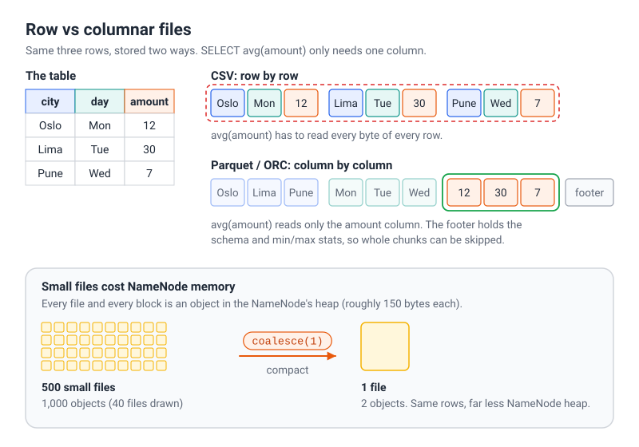

# Lab 06: File formats and small files

See why Parquet and ORC beat CSV, and why a pile of tiny files hurts HDFS.

| | |
|---|---|
| ⏱ Time | 30 minutes |
| 🧠 Docker memory | about 2.3 GB peak (core + notebook) |
| 🧩 Services | namenode, datanode, resourcemanager, nodemanager, proxy, **notebook** |
| Level | Intermediate |



## The big idea

Two choices shape how fast your data jobs are, long before you write any query:

1. **File format.** CSV and JSON are *row* formats: to read one column you still read every row in full. Parquet and ORC are *columnar*: each column is stored together, compressed, and can be read on its own.
2. **File size.** HDFS likes a few big files (close to the 128 MB block size). The NameNode keeps one in-memory entry for every file, directory and block, so thousands of tiny files waste its memory and make jobs launch thousands of tiny tasks.

You will measure both. This lab uses Spark in local mode, as in [lab 05](../05-spark-and-jupyter/README.md).

## Start

```bash
docker compose --profile notebook up -d --wait
```

Check it's up: open <http://jupyter.localhost>.

## Steps

### 1. Open the first notebook

```bash
docker compose exec notebook cp /labs/06-file-formats-and-small-files/file-formats.ipynb /labs/06-file-formats-and-small-files/small-files.ipynb /workspace/
```

Open `file-formats.ipynb` in JupyterLab and run the cells from the top (Shift+Enter).

### 2. Write the same rows four ways

The notebook generates 500,000 rows (id, user, country, amount, a text comment, a timestamp) and writes them as CSV, JSON, Parquet and ORC under `/user/lab/06/formats/`.

Each copy uses two files, so the comparison is fair.

### 3. Compare sizes in HDFS

In a terminal:

```bash
docker compose exec namenode hdfs dfs -du -h /user/lab/06/formats
```

You should see numbers in this ballpark (yours will differ a little; the order will not):

```text
33.6 M  33.6 M  /user/lab/06/formats/csv
69.0 M  69.0 M  /user/lab/06/formats/json
 9.5 M   9.5 M  /user/lab/06/formats/orc
11.3 M  11.3 M  /user/lab/06/formats/parquet
```

The first column is the file size. The second is the space used with replication (the same here, because replication is 1 in this lab).

Why is Parquet so much smaller?

- Values of one column sit together, so they compress well (the `country` column repeats five words).
- Numbers are stored as numbers, not as text.
- JSON repeats every column name on every row.

### 4. Compare read speed for one column

The notebook computes `AVG(amount)` from each copy, three times each, and keeps the best time. It then draws two bar charts.

Expected shape (seconds will differ on your laptop):

```text
  format  seconds
0    csv     2.9
1   json     4.7
2 parquet     0.4
3    orc     0.5
```

CSV and JSON must read and parse every column. Parquet and ORC read only the `amount` column and skip the rest. That trick is called **column pruning**. Parquet and ORC also keep min/max values per chunk, which lets Spark skip chunks entirely when you filter.

### 5. Look at the file layout

```bash
docker compose exec namenode hdfs dfs -ls /user/lab/06/formats/parquet
```

```text
-rw-r--r--   1 spark supergroup          0 ... /user/lab/06/formats/parquet/_SUCCESS
-rw-r--r--   1 spark supergroup    5.6 M ... part-00000-....snappy.parquet
-rw-r--r--   1 spark supergroup    5.7 M ... part-00001-....snappy.parquet
```

`_SUCCESS` is an empty marker that says "the write finished". Jobs that read this folder can wait for it.

### 6. The small files problem

Open `small-files.ipynb` and run it. It writes the same 5,000 rows twice:

- `/user/lab/06/small/many`: 500 files of about 10 rows each
- `/user/lab/06/small/one`: one file

Count them yourself:

```bash
docker compose exec namenode hdfs dfs -count /user/lab/06/small/many /user/lab/06/small/one
```

You should see (columns: directories, files, bytes, path):

```text
           1          501          ...   /user/lab/06/small/many
           1            2          ...   /user/lab/06/small/one
```

500 data files plus `_SUCCESS` is 501. Tiny files, but the NameNode tracks all of them, plus a block for each.

### 7. See it in the NameNode UI

Open <http://hdfs.localhost>. The Overview page has a line like this (your numbers will differ):

```text
2,600 files and directories, 1,500 blocks = 4,100 total filesystem object(s).
```

Every one of those objects lives in NameNode memory (rule of thumb: roughly 150 bytes each). A real cluster with hundreds of millions of tiny files runs out of NameNode memory long before it runs out of disk.

> Our 5,000-row data is only a few hundred KB in total. The same data needed 501 files in one folder and 2 in the other.

### 8. Compact

The last cells read the 500 files and write them back as one file with `coalesce(1)` into `/user/lab/06/small/compacted`.

```bash
docker compose exec namenode hdfs dfs -count /user/lab/06/small/compacted
```

```text
           1            2          ...   /user/lab/06/small/compacted
```

`coalesce(1)` is fine for tiny data. For big data, pick a partition count so files end up near 128 MB each.

## Check yourself

```bash
docker compose exec namenode bash /labs/06-file-formats-and-small-files/check.sh
```

You should see:

```text
PASS  csv copy is in /user/lab/06/formats/csv
PASS  json copy is in /user/lab/06/formats/json
PASS  parquet copy is in /user/lab/06/formats/parquet
PASS  orc copy is in /user/lab/06/formats/orc
PASS  small/many holds 500 tiny files
PASS  small/one holds a single file
PASS  small/compacted holds a single file after compaction
All 7 checks passed
```

## Break it on purpose

Make the problem ten times worse. In a new notebook cell, run:

```python
spark.range(5000).repartition(2000).write.mode("overwrite").parquet("hdfs://namenode:8020/user/lab/06/small/way-too-many")
```

Watch it in the Spark UI (<http://spark.localhost>): 2,000 tasks for 5,000 rows, and it takes far longer than the 500-file write. Then refresh <http://hdfs.localhost> and see the object count jump.

Delete it when you are done:

```bash
docker compose exec namenode hdfs dfs -rm -r -skipTrash /user/lab/06/small/way-too-many
```

## Going further

1. Find out how a Parquet file stores your data. Which compression codec does Spark use by default?
   <details><summary>Solution</summary>

   Snappy: look at the file name (`part-....snappy.parquet`). Try zstd with `.option("compression", "zstd")` on the write and compare the size.
   </details>
2. Prove column pruning with `explain()`. Select one column from the Parquet copy and read the plan.
   <details><summary>Solution</summary>

   ```python
   spark.read.parquet(f"{BASE}/parquet").select("amount").explain()
   ```
   Look at `ReadSchema: struct<amount:double>`. Only one column is read.
   </details>
3. Try a filter. Does `WHERE amount > 499` read less data from Parquet than from CSV? Compare the "number of output rows" and "size of files read" in the Spark UI SQL tab.

## Troubleshooting

| Symptom | Fix |
|---|---|
| Kernel dies while writing 500,000 rows | Memory. Close other notebooks (`spark.stop()`), or give Docker more memory ([docs/memory.md](../../docs/memory.md)). |
| `hdfs dfs -du` shows sizes much larger than expected | Check `dfs.replication`. The notebooks set it to 1. Plain `hdfs dfs -put` uses the cluster default. |
| `PATH_ALREADY_EXISTS` error | You wrote without `mode("overwrite")`. Add it, or `hdfs dfs -rm -r` the folder. |
| Write of 500 files is slow | Expected on a laptop: each file costs a few HDFS round trips. It is the point of the demo. |

More in [docs/troubleshooting.md](../../docs/troubleshooting.md).

## Clean up

```bash
docker compose --profile "*" down
```

Next: [Lab 07: SQL with Hive](../07-sql-with-hive/README.md).
