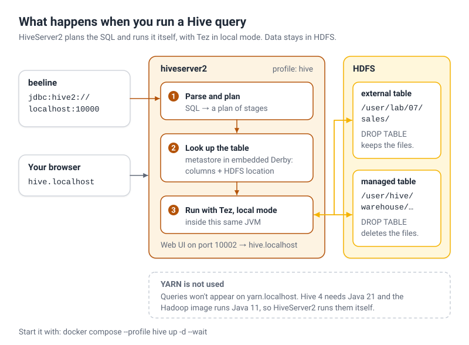

# Lab 07: SQL with Hive

Query files in HDFS with plain SQL: external tables, ORC tables, partitions, GROUP BY and JOIN.

| | |
|---|---|
| ⏱ Time | 30 minutes |
| 🧠 Docker memory | about 2.4 GB at peak |
| 🧩 Services | the core stack plus `hiveserver2` (profile `hive`) |
| Level | Intermediate |

Hive turns SQL into jobs that read and write files in HDFS. It keeps two things apart:

- **The data** is files in HDFS (CSV, ORC, Parquet...).
- **The table** is a definition (column names, types, folder) kept in the **metastore**.



An **external table** points at a folder that already exists. Drop it and the files stay. A **managed table** is owned by Hive and lives under `/user/hive/warehouse`. Drop it and the files go too.

**Queries run inside the HiveServer2 container**, using Tez in local mode. They do not run on YARN, so you will not see them in <http://yarn.localhost>. The reason is Java: Hive 4 needs Java 21 and the Hadoop image runs Java 11, so Hive code cannot start inside a YARN container. The queries still read and write real HDFS files. On a real cluster the same SQL would run as Tez jobs on YARN.

The metastore here is a small Derby database inside HiveServer2. Your tables survive `docker compose down`, but not `down -v`.

## Start

From the repo root:

```bash
docker compose --profile hive up -d --wait
```

HiveServer2 can take a minute or two to become healthy. Check it is up: open <http://hive.localhost>. You should see the HiveServer2 web page.

## Steps

### 1. Put the CSV files into HDFS

The lab ships a small `sales.csv` (300 orders) and `customers.csv` (40 customers). Each goes into its own folder, because a Hive table points at a folder, not a file. Run this on your laptop:

```bash
docker compose exec namenode bash -c '
  hdfs dfs -mkdir -p /user/lab/07/sales /user/lab/07/customers
  hdfs dfs -put -f /labs/07-sql-with-hive/data/sales.csv /user/lab/07/sales/
  hdfs dfs -put -f /labs/07-sql-with-hive/data/customers.csv /user/lab/07/customers/
  hdfs dfs -chmod -R a+rwx /user/lab
  hdfs dfs -cat /user/lab/07/sales/sales.csv | head -3
'
```

You should see:

```text
order_id,customer_id,product,country,quantity,unit_price,order_date
1,27,pen,Kenya,3,1.2,2026-01-20
2,32,lamp,Brazil,1,18.5,2026-03-27
```

The `chmod` lets the Hive user read and write under `/user/lab`.

### 2. Open beeline

Beeline is Hive's command line SQL client. It runs inside the `hiveserver2` container.

```bash
docker compose exec hiveserver2 beeline -u jdbc:hive2://localhost:10000 -n hive
```

You should see a prompt:

```text
Connected to: Apache Hive (version 4.2.1)
0: jdbc:hive2://localhost:10000>
```

Type SQL ending with `;`. Beeline's own commands start with `!` and take no `;`. Type `!quit` to leave.

### 3. An external table over the CSV

The SQL for each step is in [`sql/`](sql/). You can paste statements, or run a whole file from the beeline prompt with `!run`:

```text
!run /labs/07-sql-with-hive/sql/01-external-table.sql
```

The important statement is:

```sql
CREATE EXTERNAL TABLE sales_raw (
  order_id INT, customer_id INT, product STRING, country STRING,
  quantity INT, unit_price DOUBLE, order_date STRING
)
ROW FORMAT DELIMITED FIELDS TERMINATED BY ','
STORED AS TEXTFILE
LOCATION '/user/lab/07/sales'
TBLPROPERTIES ('skip.header.line.count' = '1');
```

No data moved. Hive only recorded "table `sales_raw` = the CSV files in this folder". The file also defines `customers_raw` the same way, and ends by counting rows. You should see `rows_in_csv` with the value `300`.

### 4. CTAS to an ORC table

CTAS means *create table as select*. This copies the CSV into a managed table stored as ORC, a compressed columnar format (see [lab 06](../06-file-formats-and-small-files/README.md)).

```text
!run /labs/07-sql-with-hive/sql/02-ctas-orc.sql
```

The main statement is:

```sql
CREATE TABLE sales_orc STORED AS ORC AS
SELECT order_id, customer_id, product, country, quantity, unit_price,
       quantity * unit_price AS revenue, order_date
FROM sales_raw;
```

The file ends with a row count (300 again) and the new table's columns. Open <http://yarn.localhost>: there is no new application, because the query ran inside HiveServer2.

### 5. Find the files with DESCRIBE FORMATTED

`DESCRIBE FORMATTED` prints everything the metastore knows about a table, including where its files are.

```sql
DESCRIBE FORMATTED sales_orc;
```

Look for these rows in the middle of the output:

```text
| Location:       | hdfs://namenode:8020/user/hive/warehouse/sales_orc |
| Table Type:     | MANAGED_TABLE                                      |
| InputFormat:    | org.apache.hadoop.hive.ql.io.orc.OrcInputFormat    |
```

Now look at the real files from a second terminal on your laptop:

```bash
docker compose exec namenode hdfs dfs -ls -R /user/hive/warehouse/sales_orc
```

You should see one ORC file:

```text
-rw-r--r--   1 hive ...        ... ... /user/hive/warehouse/sales_orc/000000_0
```

That file is the table. Do the same for the external one: `DESCRIBE FORMATTED sales_raw;` shows `EXTERNAL_TABLE` and your `/user/lab/07/sales` folder. [`05-find-the-files.sql`](sql/05-find-the-files.sql) runs both.

### 6. A partitioned table

A **partition** is a sub-folder per value of a column. A query with `WHERE country = 'Nepal'` then reads only that folder.

```text
!run /labs/07-sql-with-hive/sql/03-partitions.sql
```

The file creates `sales_by_country`, fills it from `sales_raw` and lists its partitions. You should see five, from `country=Brazil` to `country=Nepal`.

In HDFS each partition is a folder:

```bash
docker compose exec namenode hdfs dfs -ls /user/hive/warehouse/sales_by_country
```

```text
Found 5 items
drwxr-xr-x   - hive ...          0 ... /user/hive/warehouse/sales_by_country/country=Brazil
...
```

### 7. GROUP BY and JOIN

```text
!run /labs/07-sql-with-hive/sql/04-group-by-and-join.sql
```

The file runs three queries: revenue per country, the five biggest customers (a JOIN with `customers_raw`), and a new ORC table `top_products`. The first result is:

```text
+----------+---------+----------+
| country  | orders  | revenue  |
+----------+---------+----------+
| Kenya    | 91      | 3887.0   |
| Nepal    | 74      | 3078.1   |
| Brazil   | 72      | 2991.6   |
| Japan    | 35      | 1748.8   |
| India    | 28      | 1615.1   |
+----------+---------+----------+
```

Leave beeline with `!quit`.

## Check yourself

```bash
docker compose exec namenode bash /labs/07-sql-with-hive/check.sh
```

You should see:

```text
PASS  sales.csv is in /user/lab/07/sales
PASS  customers.csv is in /user/lab/07/customers
PASS  sales_orc has ORC files in the warehouse
PASS  sales_by_country has a country=Nepal partition folder
PASS  top_products has files in the warehouse

All 5 checks passed
```

## Break it on purpose

**Drop a managed table, then an external one, and look at HDFS.** Open beeline again (step 2). Make a managed copy first, so your lab tables stay safe:

```sql
CREATE TABLE sales_copy STORED AS ORC AS SELECT * FROM sales_raw;
DROP TABLE sales_copy;
```

In your second terminal:

```bash
docker compose exec namenode hdfs dfs -ls /user/hive/warehouse/sales_copy
```

You should see `No such file or directory`. Dropping a managed table deleted its files.

Now do the same with a second external table over the sales folder:

```sql
CREATE EXTERNAL TABLE sales_peek (order_id INT)
  ROW FORMAT DELIMITED FIELDS TERMINATED BY ','
  LOCATION '/user/lab/07/sales'
  TBLPROPERTIES ('skip.header.line.count' = '1');
DROP TABLE sales_peek;
```

```bash
docker compose exec namenode hdfs dfs -ls /user/lab/07/sales
```

`sales.csv` is still there. This is why people use external tables for data they do not want Hive to delete.

## Going further

1. Which product sold the most units in Japan? Use the partitioned table.

   <details><summary>Solution</summary>

   ```sql
   SELECT product, SUM(quantity) AS units
   FROM sales_by_country WHERE country = 'Japan'
   GROUP BY product ORDER BY units DESC LIMIT 1;
   ```

   `notebook`, with 28 units. Hive only reads the `country=Japan` folder.

   </details>

2. Run `EXPLAIN` on a GROUP BY query and find the Tez vertices (Map 1, Reducer 2).

   <details><summary>Solution</summary>

   ```sql
   EXPLAIN SELECT country, COUNT(*) FROM sales_orc GROUP BY country;
   ```

   The plan lists `Tez` with `Vertices:`. A vertex is a stage, like map and reduce in MapReduce.

   </details>

3. Query the lab 06 data, if you still have it. Create an external table over `/user/lab/06/formats/parquet` with `STORED AS PARQUET`.

   <details><summary>Solution</summary>

   ```sql
   CREATE EXTERNAL TABLE orders_parquet (order_id BIGINT, user_id INT, country STRING,
     amount DOUBLE, comment STRING, ts TIMESTAMP)
   STORED AS PARQUET LOCATION '/user/lab/06/formats/parquet';
   SELECT country, AVG(amount) FROM orders_parquet GROUP BY country;
   ```

   </details>

## Troubleshooting

| Symptom | Fix |
|---|---|
| `Could not open client transport` / connection refused | HiveServer2 can take a minute or two to start. Run `docker compose ps` and wait for `healthy`. |
| `Permission denied` on `/user/lab` or the warehouse | Re-run the `hdfs dfs -chmod -R a+rwx /user/lab` command from step 1. |
| `Unable to create a terminal` | Run beeline with plain `docker compose exec` (not `-T`, not piped). It needs a terminal. |
| A query seems stuck for a few seconds | Normal. Each query starts a Tez session inside HiveServer2. The first one is slowest. |
| `Table already exists` | The SQL files start with `DROP TABLE IF EXISTS`, so re-running a whole file is safe. |

More in [docs/troubleshooting.md](../../docs/troubleshooting.md).

## Clean up

Leave beeline with `!quit`, then:

```bash
docker compose --profile "*" down
```

Your tables and HDFS files stay. Add `-v` to wipe everything.

Next: [Lab 08, Iceberg tables](../08-iceberg-tables/README.md).
