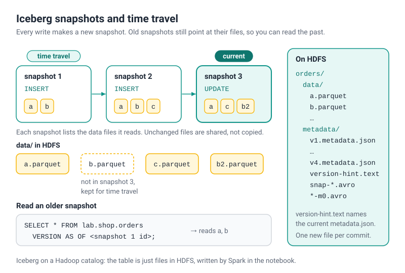

# Lab 08: Iceberg tables

Get UPDATE, DELETE, MERGE, snapshots and time travel on plain HDFS files with Apache Iceberg.

| | |
|---|---|
| ⏱ Time | 30 minutes |
| 🧠 Docker memory | about 2.3 GB at peak |
| 🧩 Services | the core stack plus `notebook` (profile `notebook`) |
| Level | Advanced |

HDFS files are write-once. You cannot change row 3 of a Parquet file. So how can a table support `UPDATE`?

**Iceberg is a table format.** It does not store data itself. It adds a small tree of metadata files next to your Parquet files:

1. A **metadata file** (`v3.metadata.json`) lists the table's schema and all its snapshots.
2. Each **snapshot** is one version of the table. It points to a manifest list.
3. **Manifests** list the data files that belong to that version.
4. **Data files** are ordinary Parquet.



An `UPDATE` writes new data files and a new snapshot. The old snapshot still points at the old files, so you can read the table as it was before. That is **time travel**.

You will use a **Hadoop catalog**: the catalog is a folder in HDFS (`/user/lab/08/warehouse`), so no Hive metastore or database is needed. Real clusters usually use a Hive, REST or cloud catalog, because with a Hadoop catalog two writers at once can clash.

Spark runs in local mode in the notebook container, as in [lab 05](../05-spark-and-jupyter/README.md). The image ships Spark 4.1.3 with the Iceberg 1.12 runtime jar already on its classpath.

## Start

From the repo root:

```bash
docker compose --profile notebook up -d --wait
```

Check it is up: open <http://jupyter.localhost>. All `docker compose` commands in this lab run on your laptop.

## Steps

### 1. Open the notebook

Copy the notebook into your workspace so you can edit and save it.

```bash
docker compose exec notebook cp /labs/08-iceberg-tables/iceberg-orders.ipynb /workspace/
```

Open `iceberg-orders.ipynb` in JupyterLab and run the cells one at a time (Shift+Enter) as you read the steps below. First make sure no other notebook still has a Spark session running (**Kernel > Shut Down All Kernels**): two Spark sessions in 1.5 GB of memory is tight.

### 2. Configure the catalog

The first cell sets up Spark and names the catalog `lab`:

```python
.config("spark.sql.extensions", "org.apache.iceberg.spark.extensions.IcebergSparkSessionExtensions")
.config("spark.sql.catalog.lab", "org.apache.iceberg.spark.SparkCatalog")
.config("spark.sql.catalog.lab.type", "hadoop")
.config("spark.sql.catalog.lab.warehouse", "hdfs://namenode:8020/user/lab/08/warehouse")
```

- The *extensions* line turns on `UPDATE`, `DELETE` and `MERGE` for Iceberg tables.
- `lab` is the catalog name. Tables are now written `lab.<namespace>.<table>`.
- `type=hadoop` means "keep the catalog in the warehouse folder".

### 3. Create a table and insert rows

The table lives in the namespace `shop`, which is Iceberg's word for a database.

```sql
CREATE TABLE lab.shop.orders (
  order_id BIGINT, customer STRING, item STRING,
  qty INT, price DECIMAL(8, 2), status STRING
) USING iceberg
```

Then `INSERT` five rows. You should see them listed:

```text
+--------+--------+--------+---+-----+---------+
|order_id|customer|    item|qty|price|   status|
+--------+--------+--------+---+-----+---------+
|       1|    asha|notebook|  2| 3.50|      new|
...
```

### 4. Update, delete and merge

The notebook then runs:

- `UPDATE ... SET status = 'shipped' WHERE order_id IN (1, 2)`
- `DELETE FROM ... WHERE status = 'cancelled'`
- `MERGE INTO ... USING incoming` (an upsert: order 3 changes, order 6 is new)

Each statement creates a new snapshot. None of them edits an HDFS file in place.

### 5. List the snapshots

The next cell queries `lab.shop.orders.snapshots`. It is a **metadata table**, queried like any other. You should see four rows:

```text
+-------------------+-----------------------+---------+-----+-------+
|snapshot_id        |committed_at           |operation|added|deleted|
+-------------------+-----------------------+---------+-----+-------+
|8189...            |2026-11-18 10:02:11.4..|append   |5    |NULL   |
|3301...            |2026-11-18 10:02:14.9..|overwrite|...  |...    |
|6740...            |2026-11-18 10:02:16.1..|overwrite|...  |...    |
|5512...            |2026-11-18 10:02:19.7..|overwrite|...  |...    |
+-------------------+-----------------------+---------+-----+-------+
```

The IDs and times will be different. There is **one row per change**: the insert, the update, the delete and the merge.

Look at `added` and `deleted` for the update. They are larger than the two rows you changed. By default Iceberg works **copy-on-write**: it cannot edit a data file, so it writes a new copy of the whole file with the change applied and drops the old file from the snapshot. The counts are the rows in those files.

Other metadata tables to try: `.history`, `.files`, `.manifests`.

### 6. Time travel

Old snapshots still point at their old files, so you can query them. There are two ways to go back:

```sql
SELECT * FROM lab.shop.orders VERSION AS OF 8189...;                      -- by snapshot id
SELECT * FROM lab.shop.orders TIMESTAMP AS OF '2026-11-18 10:02:14.900';  -- by time
```

The notebook fills in the real ID and time for you. The first query shows the original five rows, including the cancelled order that the current table no longer has. The second shows the table as it was after the update.

### 7. Evolve the schema

Add a column, rename another, then insert one more row.

```sql
ALTER TABLE lab.shop.orders ADD COLUMN coupon STRING;
ALTER TABLE lab.shop.orders RENAME COLUMN qty TO quantity;
```

Old rows show `NULL` in `coupon`. No data file was rewritten, only metadata changed. Compare that with a plain Hive table, where renaming a column often means rewriting the files.

### 8. See the files in HDFS

The last cells list the table folder. You can see the same from a terminal:

```bash
docker compose exec namenode hdfs dfs -ls -R /user/lab/08/warehouse/shop/orders
```

You should see (trimmed):

```text
.../orders/data/00000-3-....parquet
.../orders/data/00000-12-....parquet
.../orders/metadata/v1.metadata.json ... v8.metadata.json
.../orders/metadata/snap-8189...-1-....avro
.../orders/metadata/....-m0.avro
.../orders/metadata/version-hint.text
```

Match them to the picture:

- `vN.metadata.json`: one per table change. The notebook makes eight: the create, the insert, update, delete and merge, two `ALTER`s and the last insert.
- `version-hint.text`: a tiny file that holds the number of the current `vN.metadata.json`.
- `snap-*.avro`: a manifest list, one per snapshot.
- `*-m0.avro`: a manifest, listing data files with row counts and min/max values.
- `data/*.parquet`: the rows.

To read the newest metadata file, replace `8` with the number in `version-hint.text`:

```bash
docker compose exec namenode bash -c \
  "hdfs dfs -cat /user/lab/08/warehouse/shop/orders/metadata/v8.metadata.json | jq '.schemas[-1].fields[].name'"
```

You should see the column names, with `quantity` and `coupon` among them.

The data files of earlier snapshots are still there. That is what makes time travel work, and it is why real tables need old snapshots expired (see Going further).

## Check yourself

```bash
docker compose exec namenode bash /labs/08-iceberg-tables/check.sh
```

You should see:

```text
PASS  the table has a version-hint.text
PASS  metadata/ holds 8 vN.metadata.json files (one per table change)
PASS  data/ holds Parquet files
PASS  the schema in metadata includes the coupon column (schema evolution)

All 4 checks passed
```

## Break it on purpose

**Delete the metadata and see what is left.** The last cell stopped Spark, so run the first code cell again to get a session back. Then make a throw-away table in a new cell at the bottom, so your lab table stays safe:

```python
spark.sql("CREATE TABLE lab.shop.scratch (id INT) USING iceberg")
spark.sql("INSERT INTO lab.shop.scratch VALUES (1), (2)")
```

Then in a terminal, remove only the metadata folder:

```bash
docker compose exec namenode hdfs dfs -rm -r -skipTrash /user/lab/08/warehouse/shop/scratch/metadata
```

Back in the notebook:

```python
spark.sql("SELECT * FROM lab.shop.scratch").show()
```

The query fails. Depending on what Spark had cached, you get a `NoSuchTableException` or a file-not-found error for a metadata file. The Parquet files in `data/` are still in HDFS, but without metadata nothing knows they form a table. The metadata *is* the table.

Remove what is left: `docker compose exec namenode hdfs dfs -rm -r /user/lab/08/warehouse/shop/scratch`.

## Going further

These run in new cells with a running session (run the first code cell again). Do them in this order: expiring snapshots removes the one that exercise 1 rolls back to.

1. Roll the table back to its first snapshot, then forward again.

   <details><summary>Solution</summary>

   ```python
   ids = [r[0] for r in spark.sql("SELECT snapshot_id FROM lab.shop.orders.snapshots ORDER BY committed_at").collect()]
   spark.sql(f"CALL lab.system.rollback_to_snapshot('shop.orders', {ids[0]})")
   spark.sql("SELECT * FROM lab.shop.orders ORDER BY order_id").show()
   spark.sql(f"CALL lab.system.set_current_snapshot('shop.orders', {ids[-1]})")
   ```

   A rollback only moves the "current" pointer. No snapshot is deleted, so you can move forward again.

   </details>

2. Compact small files, like lab 06, but with Iceberg's own procedure.

   <details><summary>Solution</summary>

   ```python
   spark.sql("CALL lab.system.rewrite_data_files(table => 'shop.orders', options => map('rewrite-all', 'true'))").show()
   ```

   A new snapshot with `operation = replace` appears.

   </details>

3. Expire old snapshots to free space. What happens to time travel?

   <details><summary>Solution</summary>

   ```python
   spark.sql("""
     CALL lab.system.expire_snapshots(table => 'shop.orders',
       older_than => TIMESTAMP '2999-01-01 00:00:00', retain_last => 1)
   """).show()
   ```

   Only the newest snapshot is kept and the data files nothing points at are deleted. `VERSION AS OF <old id>` now fails.

   </details>

## Troubleshooting

| Symptom | Fix |
|---|---|
| `ClassNotFoundException: org.apache.iceberg.spark.SparkCatalog` | The Iceberg jar is missing from the notebook image. Rebuild it: `docker compose --profile notebook build notebook`, then run the Start command again. |
| `Cannot call methods on a stopped SparkContext` | The last cell stopped Spark. Run the first code cell again. |
| `UPDATE` or `MERGE` fails with "not supported" | The `spark.sql.extensions` line was lost. Restart the kernel and run the first cell again. |
| `Table already exists` after a half-finished run | Run the first cells again. The notebook drops and recreates `lab.shop.orders` with `PURGE`. |
| Kernel dies (`Killed`) | Memory. Shut down other kernels (**Kernel > Shut Down All Kernels**) and run again. |

More in [docs/troubleshooting.md](../../docs/troubleshooting.md).

## Clean up

Leave the stack running for the next lab, which adds Kafka to it, or stop it:

```bash
docker compose --profile "*" down
```

Your HDFS files, including the Iceberg table, stay.

Next: [Lab 09, Kafka streaming into HDFS](../09-kafka-streaming/README.md).
