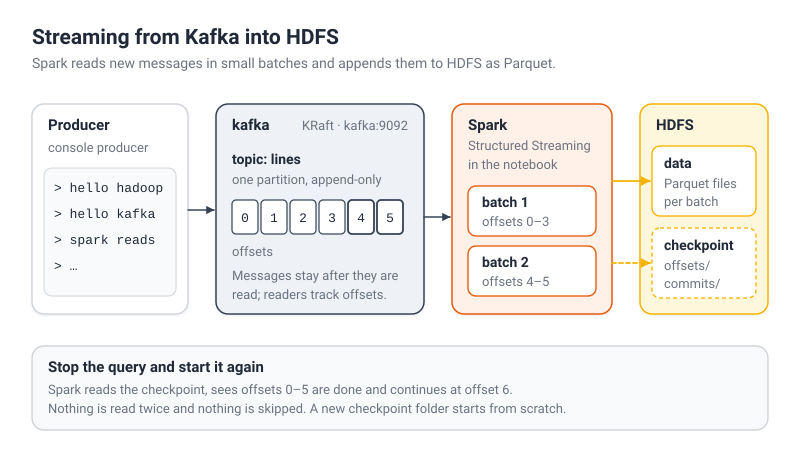

# Lab 09: Kafka streaming into HDFS

Send lines into a Kafka topic, let Spark count the words as they arrive, and save the lines to HDFS as Parquet without losing or repeating any, even if you stop and restart.

| | |
|---|---|
| ⏱ Time | 60 minutes |
| 🧠 Docker memory | about 2.4 GB at peak (fits in 3 GB with swap; 4 GB is more comfortable) |
| 🧩 Services | the core stack plus `kafka` and `notebook` (profiles `kafka` and `notebook`) |
| Level | Advanced |

Kafka is a log: producers append messages, readers remember how far they have read. That "how far" is called an **offset**. Spark Structured Streaming turns the log into a table that grows, and runs your query on every new chunk (a **micro-batch**).



Spark runs in local mode in the notebook container, as in [lab 05](../05-spark-and-jupyter/README.md). The image ships the Kafka connector jars.

## Start

This lab needs two add-ons, so it takes two `--profile` flags. From the repo root:

```bash
docker compose --profile kafka --profile notebook up -d --wait
```

Check it is up: `docker compose --profile "*" ps` should list `kafka` and `notebook` as `healthy`, next to the Hadoop services. If you skipped the earlier notebook labs, the first start builds the notebook image, so allow a few minutes.

All commands in this lab run on your laptop. Memory is tight with two add-ons, so do not run MapReduce jobs at the same time.

## Steps

### 1. Create a topic

A topic is a named log. Make one with a single partition, so offsets are easy to read.

```bash
docker compose exec kafka /opt/kafka/bin/kafka-topics.sh \
  --bootstrap-server kafka:9092 --create --if-not-exists \
  --topic lines --partitions 1 --replication-factor 1
```

You should see:

```text
Created topic lines.
```

Replication factor is 1 because there is only one broker. This broker also acts as its own controller (KRaft mode), so there is no ZooKeeper to run.

### 2. Produce some lines

The console producer sends every line you type as one message. Start it:

```bash
docker compose exec kafka /opt/kafka/bin/kafka-console-producer.sh \
  --bootstrap-server kafka:9092 --topic lines
```

At the `>` prompt, paste these six lines and press Enter:

```text
hadoop stores data in hdfs
yarn runs jobs on hadoop
kafka moves data in streams
spark reads streams from kafka
hdfs keeps the streamed data
streams of data never stop
```

Press `Ctrl+D` to leave. The same lines are in [sample-lines.txt](sample-lines.txt). In bash or zsh you can pipe them in instead of typing:

```bash
docker compose exec -T kafka /opt/kafka/bin/kafka-console-producer.sh \
  --bootstrap-server kafka:9092 --topic lines < labs/09-kafka-streaming/sample-lines.txt
```

Do one or the other, not both, or every line is in the topic twice.

### 3. Look at offsets

Kafka keeps the messages after they are sent. Ask where the log ends:

```bash
docker compose exec kafka /opt/kafka/bin/kafka-get-offsets.sh \
  --bootstrap-server kafka:9092 --topic lines
```

You should see:

```text
lines:0:6
```

That reads "topic `lines`, partition `0`, next offset `6`": six messages numbered 0 to 5. Reading does not remove them, so you can read them again:

```bash
docker compose exec kafka /opt/kafka/bin/kafka-console-consumer.sh \
  --bootstrap-server kafka:9092 --topic lines --from-beginning --timeout-ms 5000
```

You should see the six lines, then:

```text
Processed a total of 6 messages
```

### 4. Count words as they arrive

Copy the notebook into your workspace so you can edit and save it. Then open <http://jupyter.localhost> and double-click `streaming.ipynb`.

```bash
docker compose exec notebook cp /labs/09-kafka-streaming/streaming.ipynb /workspace/
```

Run the cells from the top down to the first word count (Shift+Enter runs a cell). The query reads the topic from the earliest offset and keeps a running table in memory.

You should see:

```text
+-------+-----+
|   word|count|
+-------+-----+
|   data|    4|
|streams|    3|
| hadoop|    2|
|   hdfs|    2|
|     in|    2|
|  kafka|    2|
|   from|    1|
|   jobs|    1|
+-------+-----+
```

Now the streaming part. Start the producer from step 2 again, type one more line (for example `hadoop loves data`) and leave with `Ctrl+D`. Then run the next cell. `hadoop` and `data` each go up by one. Nothing was restarted: the same query picked up the new message. The cell after that stops the query.

### 5. Save the stream to HDFS with a checkpoint

Run the "Land the raw lines in HDFS" cell. It writes Parquet files to `/user/lab/09/lines` and records its progress in `/user/lab/09/checkpoints/lines`. It uses `trigger(availableNow=True)`: handle everything that is waiting, then stop. That makes a streaming query finish, which is what you want in a lab or a test.

Run the next cell too. It reads the Parquet files back. Between the two cells you should see (the row count matches the lines you produced):

```text
batches in the last run: 1
rows in HDFS: 7
```

Look at the result from your terminal:

```bash
docker compose exec namenode hdfs dfs -ls /user/lab/09/lines /user/lab/09/checkpoints/lines
```

You should see:

```text
drwxr-xr-x   - spark supergroup          0 ... /user/lab/09/lines/_spark_metadata
-rw-r--r--   1 spark supergroup        ... ... /user/lab/09/lines/part-00000-....snappy.parquet
...
drwxr-xr-x   - spark supergroup          0 ... /user/lab/09/checkpoints/lines/commits
-rw-r--r--   1 spark supergroup        ... ... /user/lab/09/checkpoints/lines/metadata
drwxr-xr-x   - spark supergroup          0 ... /user/lab/09/checkpoints/lines/offsets
drwxr-xr-x   - spark supergroup          0 ... /user/lab/09/checkpoints/lines/sources
```

### 6. Stop, add data, run again

The query has stopped. Produce two more lines, then run the Parquet cell and the "rows in HDFS" cell again.

You should see:

```text
batches in the last run: 1
rows in HDFS: 9
```

Exactly two new rows, not nine more. The checkpoint told Spark "I already handled offsets 0 to 6", so it only read the new ones. Run the Parquet cell a third time with no new lines: no batch runs and the count stays at 9.

Run the last two cells. The first lists the checkpoint folder. The second prints `offsets/0`, a small text file:

```text
v1
{"batchWatermarkMs":0,"batchTimestampMs":...}
{"lines":{"0":7}}
```

The last line says "after this batch, the next offset to read for partition 0 is 7".

### 7. Why no line is lost or repeated

- **Offset:** a message's position in a partition. Kafka does not track who read what; the reader does.
- **Checkpoint:** the reader's notebook. Before a batch runs, Spark writes the offsets it is about to read (`offsets/N`). After the batch's files are in place, it writes `commits/N`.
- **Exactly-once, roughly:** if Spark dies half-way through batch N, the restart sees `offsets/N` but no `commits/N`, so it reads the same offsets again. That is safe because Kafka can replay and the Parquet sink lists the files of each finished batch in `_spark_metadata`, so a batch is never added twice. A replayable source plus a sink that ignores repeats gives "exactly-once-ish" results from the outside. It does not hold for every sink.

## Check yourself

```bash
docker compose exec namenode bash /labs/09-kafka-streaming/check.sh
```

You should see:

```text
PASS  Parquet output folder /user/lab/09/lines
PASS  Sink log /user/lab/09/lines/_spark_metadata
PASS  Parquet part files exist in /user/lab/09/lines
PASS  Checkpoint offsets log
PASS  Checkpoint commit log

All 5 checks passed
```

## Break it on purpose

**Make the checkpoint lie.** It remembers offset 9, so delete the topic and create a new, shorter one:

```bash
docker compose exec kafka /opt/kafka/bin/kafka-topics.sh --bootstrap-server kafka:9092 --delete --topic lines
docker compose exec kafka /opt/kafka/bin/kafka-topics.sh --bootstrap-server kafka:9092 --create --topic lines --partitions 1 --replication-factor 1
echo "just one line" | docker compose exec -T kafka /opt/kafka/bin/kafka-console-producer.sh --bootstrap-server kafka:9092 --topic lines
```

Run the Parquet cell again. It stops with an error like:

```text
StreamingQueryException: ... Partition lines-0's offset was changed from 9 to 1,
some data may have been missed.
```

Spark noticed that the log is shorter than what its checkpoint says it has read, and refused to carry on silently. To start over, point the query at new `checkpointLocation` and `path` folders (for example `/user/lab/09/lines-v2`), or remove both folders from HDFS first.

## Going further

1. Create a topic `lines2` with `--partitions 2`, produce a few lines, and run `kafka-get-offsets.sh` on it. What do you see?

   <details><summary>Solution</summary>

   You get one line per partition, for example `lines2:0:3` and `lines2:1:3`. The producer spreads messages over the partitions, not always evenly. Order is only guaranteed inside one partition.

   </details>

2. Count words per minute. Change the word count to group by `window("timestamp", "1 minute")` as well as `word`.

   <details><summary>Solution</summary>

   ```python
   counts = (lines.select(F.window("timestamp", "1 minute").alias("minute"),
                          F.explode(F.split("line", r"\s+")).alias("word"))
             .groupBy("minute", "word").count())
   ```

   The `timestamp` column is when Kafka stored the message.

   </details>

3. Keep a query running. Replace `availableNow=True` with `processingTime="10 seconds"` and drop `awaitTermination()`. Produce lines while it runs, then stop it.

   <details><summary>Solution</summary>

   ```python
   q = (lines.writeStream.format("parquet")
        .option("path", f"{BASE}/lines-live")
        .option("checkpointLocation", f"{BASE}/checkpoints/lines-live")
        .trigger(processingTime="10 seconds").start())
   ```

   Check `q.status` and `q.lastProgress`, and stop it with `q.stop()` when you are done.

   </details>

## Troubleshooting

| Symptom | Fix |
|---|---|
| `Failed to find data source: kafka` | The notebook image is old. Rebuild: `docker compose --profile notebook build notebook`, then `up -d` again. |
| Spark waits forever or says `Connection to node -1 could not be established` | Kafka isn't running or the topic name is misspelled. `docker compose ps kafka`, and check the `--topic` spelling. |
| Kernel dies or `kafka`/`notebook` shows `Exited (137)` | Out of memory. Close other apps, give Docker 4 GB, see [docs/memory.md](../../docs/memory.md). |
| Parquet count doesn't grow | You ran the cell before producing. Produce first, then re-run the Parquet cell. |

More in [docs/troubleshooting.md](../../docs/troubleshooting.md).

## Clean up

Lab 10 uses only the core stack, so stop this one:

```bash
docker compose --profile "*" down
```

Your HDFS files and Kafka messages stay. Add `-v` to wipe everything.

Next: [Lab 10, Tuning YARN](../10-tuning-yarn/README.md).
