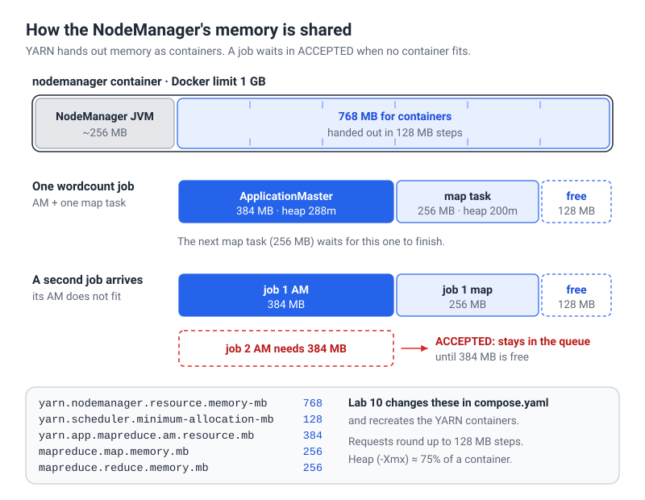

# Lab 10: Tuning YARN

Read how much room your NodeManager has, work out how many tasks fit, make a job wait on purpose, then change the cluster's settings and see what moves.

| | |
|---|---|
| ⏱ Time | 45 min |
| 🧠 Docker memory | about 3 GB (core only, peak 2.2 GB) |
| 🧩 Services | core (`namenode`, `datanode`, `resourcemanager`, `nodemanager`, `proxy`) |
| Level | Advanced |



YARN hands out memory in **containers**. A job asks for some, and the **ResourceManager** says yes only if the **NodeManager** has room. When it doesn't, the job waits. That wait is what you'll see here.

## Start

```bash
docker compose up -d --wait
```

Check it's up: <http://yarn.localhost> opens, and `docker compose ps` shows all services running. Open a shell for the commands below:

```bash
docker compose exec namenode bash
```

## Steps

### 1. Read the cluster's capacity

Open <http://yarn.localhost>. Look at the cluster metrics at the top and at **Nodes** in the left menu. Or ask the ResourceManager's REST API from the shell:

```bash
curl -s http://yarn.localhost/ws/v1/cluster/metrics | jq '.clusterMetrics | {totalMB, totalVirtualCores, availableMB}'
```

You should see:

```json
{
  "totalMB": 768,
  "totalVirtualCores": 2,
  "availableMB": 768
}
```

This comes from `yarn.nodemanager.resource.memory-mb` (768) and `cpu-vcores` (2) in [compose.yaml](../../compose.yaml). The NodeManager container has a 1 GB limit; 768 MB of it is lent to jobs and the rest is the NodeManager's own JVM.

Two more limits matter:

| Setting | Value | Meaning |
|---|---|---|
| `yarn.scheduler.minimum-allocation-mb` | 128 | Every request is rounded up to a multiple of this. |
| `yarn.scheduler.maximum-allocation-mb` | 768 | One container may not be bigger than this. |

### 2. Do the sums

A wordcount job needs one **ApplicationMaster** (AM, the job's coordinator) at 384 MB, plus map containers at 256 MB each.

```text
768 MB total
- 384 MB ApplicationMaster
= 384 MB left
384 / 256 = 1.5  ->  1 map container at a time (128 MB unused)
```

So this cluster runs **one map at a time**, however many map tasks the job has. The other tasks queue. (YARN here counts memory only; the 2 vcores are shown but not enforced.)

### 3. Run a job with many maps

Wordcount makes one map task per input file. Make six small files:

```bash
hdfs dfs -mkdir -p /user/lab/10/input
for i in 1 2 3 4 5 6; do
  echo "hadoop yarn container $i hadoop memory" | hdfs dfs -put - /user/lab/10/input/file-$i.txt
done
```

Start the job and leave it running:

```bash
hadoop jar /opt/hadoop/share/hadoop/mapreduce/hadoop-mapreduce-examples-3.4.2.jar \
  wordcount /user/lab/10/input /user/lab/10/out-baseline
```

Open a **second terminal** (`docker compose exec namenode bash`) and watch YARN while the job runs:

```bash
for i in $(seq 1 10); do
  curl -s http://yarn.localhost/ws/v1/cluster/metrics | jq -c '.clusterMetrics | {allocatedMB, availableMB, containersAllocated, containersPending}'
  sleep 5
done
```

You should see something like:

```text
{"allocatedMB":384,"availableMB":384,"containersAllocated":1,"containersPending":0}
{"allocatedMB":640,"availableMB":128,"containersAllocated":2,"containersPending":5}
{"allocatedMB":640,"availableMB":128,"containersAllocated":2,"containersPending":4}
```

Two containers (AM and one map) use 640 MB. 128 MB is free, which is too small for another 256 MB map, so five wait in `containersPending`. Also look at the **Applications** page: the job has one running attempt, and as each map finishes the next one starts. The first job takes a minute or two.

### 4. Break it on purpose

Ask for an ApplicationMaster bigger than the biggest container YARN allows:

```bash
hadoop jar /opt/hadoop/share/hadoop/mapreduce/hadoop-mapreduce-examples-3.4.2.jar \
  wordcount -Dyarn.app.mapreduce.am.resource.mb=1024 \
  /user/lab/10/input /user/lab/10/out-toobig
```

You should see the job refused straight away:

```text
org.apache.hadoop.yarn.exceptions.InvalidResourceRequestException:
Invalid resource request! Cannot allocate containers as requested resource is greater than
maximum allowed allocation. Requested resource type=[memory-mb], Requested resource=<memory:1024, vCores:1>,
maximum allowed allocation=<memory:768, vCores:2>, please note that maximum allowed allocation is
calculated by scheduler based on maximum resource of registered NodeManagers ...
```

Read it left to right: *what you asked for* (1024 MB) and *the ceiling* (768 MB). Nothing is wrong with the cluster; the request can never fit, so YARN says no at the door instead of letting it wait forever. The same message appears if a map or reduce request (`-Dmapreduce.map.memory.mb=1024`) is too big; it shows up in the ApplicationMaster's log instead of your terminal.

### 5. Tune the job, not the cluster

You can shrink a job's containers with `-D` options, with no restart. Smaller maps (and a smaller heap inside each) mean more of them fit:

```bash
hadoop jar /opt/hadoop/share/hadoop/mapreduce/hadoop-mapreduce-examples-3.4.2.jar \
  wordcount \
  -Dmapreduce.map.memory.mb=128 -Dmapreduce.map.java.opts=-Xmx100m \
  -Dmapreduce.reduce.memory.mb=128 -Dmapreduce.reduce.java.opts=-Xmx100m \
  /user/lab/10/input /user/lab/10/out-tuned
```

Run the metrics loop from step 3 again in the second terminal. Now `(768 - 384) / 128 = 3` maps run side by side:

```text
{"allocatedMB":768,"availableMB":0,"containersAllocated":4,"containersPending":3}
```

Compare **Elapsed** for both jobs on the Applications page. The tuned job should finish sooner, though the AM start-up time is the same, so the win is smaller than you might expect. Make containers too small and tasks run out of heap (`OutOfMemoryError`, or exit code 143/137): trading memory for parallelism has a floor.

### 6. Tune the cluster with a compose override

Some settings belong to the ResourceManager, so the job can't change them. Here we add a second **queue**. Queues split the cluster between groups of users or kinds of work: `default` (interactive) and `batch` (long jobs).

The file [compose.override-example.yaml](compose.override-example.yaml) sets the queues as environment variables on the `resourcemanager`. Apply it by naming both files, then recreate only the ResourceManager (type `exit` first to leave the shell; this runs on your computer):

```bash
docker compose -f compose.yaml -f labs/10-tuning-yarn/compose.override-example.yaml \
  up -d --no-deps --force-recreate resourcemanager
```

The NodeManager notices and registers again. Wait until it is back:

```bash
docker compose exec namenode bash -c "curl -s http://yarn.localhost/ws/v1/cluster/metrics | jq '.clusterMetrics.activeNodes'"
```

You should see `1` after 10 to 30 seconds (it can be `0` for a moment). Now look at the queues:

```bash
docker compose exec namenode yarn queue -status batch
```

```text
Queue Information :
Queue Name : batch
	State : RUNNING
	Capacity : 50.0%
	Current Capacity : .0%
	Maximum Capacity : 100.0%
	Default Node Label expression : <DEFAULT_PARTITION>
	Accessible Node Labels : *
	Preemption : disabled
```

Open **Scheduler** in the YARN UI: two bars, `default` and `batch`, each guaranteed half of the 768 MB but allowed to borrow up to all of it while the other is idle.

> To go back, run plain `docker compose up -d --force-recreate resourcemanager`. Without both `-f` flags compose uses only `compose.yaml`. The override is not applied by accident because its name is not `compose.override.yaml`.

### 7. Submit to a queue

```bash
hadoop jar /opt/hadoop/share/hadoop/mapreduce/hadoop-mapreduce-examples-3.4.2.jar \
  wordcount -Dmapreduce.job.queuename=batch \
  /user/lab/10/input /user/lab/10/out-queue
```

Run it in a shell again (`docker compose exec namenode bash`). In the Applications page, the **Queue** column says `batch`. While it runs, the Scheduler page shows the `batch` bar filling up.

Now submit two jobs at once, one without `queuename` (goes to `default`) and one to `batch`, from two terminals. Both get a share, and you can see each queue's usage separately.

## Check yourself

```bash
docker compose exec namenode bash /labs/10-tuning-yarn/check.sh
```

You should see:

```text
PASS  Baseline job finished (out-baseline)
PASS  Baseline wordcount output
PASS  Tuned job finished (out-tuned)
PASS  Job in the batch queue finished (out-queue)
PASS  Scheduler has a queue named batch
PASS  A finished application ran in queue batch
All 6 checks passed
```

## Going further

1. **Why does a job sit in `ACCEPTED`?** Start two wordcounts at once with the default config. What do you see, and why?
   <details><summary>Solution</summary>

   The second job usually stays in `ACCEPTED` until the first one finishes. A job only goes to `RUNNING` when its ApplicationMaster has a container. The scheduler also limits how much of a queue ApplicationMasters may hold (`yarn.scheduler.capacity.maximum-am-resource-percent`, 10 percent by default), and always lets at least the first one in. Other causes: not enough free memory for the AM, or a queue at its maximum capacity.
   </details>
2. **Rounding.** Add `YARN-SITE.XML_yarn.scheduler.minimum-allocation-mb: "256"` to the override, recreate the ResourceManager, and run the tuned job (128 MB maps). What memory does each container get?
   <details><summary>Solution</summary>

   256 MB, because requests are rounded up to a multiple of the minimum. The 3-at-a-time speed-up from step 5 goes away. `allocatedMB` in the metrics loop shows it.
   </details>
3. **Fewer reducers.** Add `-Dmapreduce.job.reduces=1` and compare **Counters** (reached from the job's page) with a run using `-Dmapreduce.job.reduces=2`. Does the output change?
   <details><summary>Solution</summary>

   With 2 reducers you get `part-r-00000` and `part-r-00001`, each holding some of the words. Total counts are the same. On a one-node cluster extra reducers add start-up cost and no speed.
   </details>

## Troubleshooting

| Symptom | Fix |
|---|---|
| `curl: Could not resolve host: yarn.localhost` | Run it inside the namenode shell, or open the URL in your browser. |
| After step 6 `activeNodes` stays `0` | Wait a minute. If still 0, `docker compose restart nodemanager`. |
| A job in the `batch` queue stays in `ACCEPTED` or its maps never start | The override must include the `user-limit-factor` lines; with the default of 1 a user can't use more than the queue's own half. |
| `Queue 'batch' does not exist` | The override wasn't applied. Check you passed both `-f` files and recreated `resourcemanager`. |
| Output directory already exists | `hdfs dfs -rm -r /user/lab/10/out-baseline` (or the one you reused). |

More in [docs/troubleshooting.md](../../docs/troubleshooting.md).

## Clean up

```bash
docker compose --profile "*" down        # keeps HDFS data
docker compose --profile "*" down -v     # also wipes it
```

You've finished the labs. Go back to the [learning path](../../README.md), or look at [how this maps to a manual VM install](../../docs/vm-install-comparison.md).
